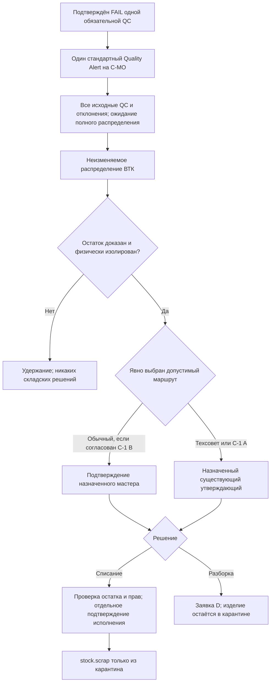

# Этап C: GAP и архитектура обработки производственного брака

**Статус: решения согласованы пользователем; реализация 17.0.2.57 завершена локально. Браузерная приёмка BLOCKED, публикация и обновление staging не выполнены.**

Дата: 22.11.2026, Europe/Kiev. Исходная версия `quality_vataga 17.0.2.56`, локальный commit `c6e2661e`. При исходном анализе manifest удалённой ветки `staging` прочитан через GitHub; версия совпадала. Описание исходных документов ниже относится к тому чтению. Во время последующей локальной реализации документы, группы и остатки staging не изменялись.

Согласовано: **C-1 A** — мастер только предлагает, утверждает назначенный существующий техсовет, исполняет тот же пользователь с правами склада; **C-2** — стандартное списание всего доказанного остатка из карантина, разборка и компоненты только в D; **C-3** — ручная передача с причиной, только новые явно включённые CAB MO, без подключения старого эталона. Вариант C-1 B ниже сохранён как история рассмотренной альтернативы и **не реализован**. Новых групп и назначений нет.

Пользователь отдельно поручил завершить локальную реализацию и доступные проверки без восстановления/обхода браузерных инструментов, зафиксировать коммит, оставить браузерную приёмку BLOCKED. Итоги: [STAGE_C_IMPLEMENTATION_AND_TEST_REPORT_RU.md](STAGE_C_IMPLEMENTATION_AND_TEST_REPORT_RU.md).

## 1. Подтверждённая исходная ситуация

В браузере повторно прочитано [распределение 13](https://vataga-staging.erpu.cloud/web#id=13&model=quality.production.disposition&view_type=form&cids=1):

| Объект | Подтверждённые данные |
|---|---|
| MO | [CAB/MO/05300, ID 16490](https://vataga-staging.erpu.cloud/web#id=16490&model=mrp.production&view_type=form&cids=1) |
| QC | [QC00606, ID 606](https://vataga-staging.erpu.cloud/web#id=606&model=quality.check&view_type=form&cids=1), FAIL |
| Товар / lot | AQC-B-1122 Lot Product / AQC-B56-MIX-COMPLETE, lot ID 2440 |
| Фактически изготовлено | 5 шт., проведённый производственный приход сохранён |
| Выпущено | 3 шт., [CAB/INT/00076, ID 43846](https://vataga-staging.erpu.cloud/web#id=43846&model=stock.picking&view_type=form&cids=1), done |
| Удержано | 2 шт.; исходные результаты 3 PASS / 2 FAIL сохранены |
| Уже существующий Alert | [QA00057, ID 67](https://vataga-staging.erpu.cloud/web#id=67&model=quality.alert&view_type=form&cids=1), вручную созданный в предыдущей проверке |

В QA00057 сохранены отклонения образцов №4 и №5, но старый блок «Вся утримана партія» показывает **5**, поскольку читает первоначальный приход. Решение не утверждено. В предыдущей регрессии его отправка была безопасно отклонена. В этом анализе кнопки согласования/исполнения не нажимались.

Доказательства чтения: [распределение 5/3/2](../../output/quality-stage-c-design-20261122/baseline-disposition13-five-three-two.jpg), [Alert с первоначальными 5](../../output/quality-stage-c-design-20261122/baseline-alert67-original-five.jpg).

Этот случай уже имеет исторический Alert. Новую автоматизацию нельзя запускать над ним как массовое заполнение пропусков и создавать второй канонический документ без явного решения о подключении старых случаев.

## 2. GAP по требованиям

| Требование | Уже есть в .56 | GAP / необходимое изменение |
|---|---|---|
| Автоматический производственный Alert при FAIL | Стандартное ручное создание; безопасный HTML описания отклонений | Нет автоматического канонического Alert на производственный случай и защиты от дублей между несколькими QC |
| Состав отклонений | `_get_technical_board_failure_description()` включает образцы, показатели, фактические значения, причины, первоначальные отклонения | Описание сейчас привязано к одной `check_id`; нужны ссылки и неизменяемые доказательства всех обязательных QC случая |
| Разделение факта и результата | `quality.production.disposition`: факт 5, исходные good/bad, snapshot, источники и release moves | Нет независимой управляемой обработки оставшегося количества и её складского аудита |
| Решение по остатку 2 | Старый `_get_board_batch()` возвращает количество первоначального прихода 5 | Нельзя просто заменить подпись/число в интерфейсе: старый исполнитель полного выпуска копирует все строки источника |
| Защита выпущенных 3 | Защищённые движения и UNIQUE канонического release; после частичного выпуска старый техсовет блокируется | Новому C-пути нужен собственный подтверждённый остаточный объём, без повторного использования done release move |
| Мастер | В модуле нет отдельной согласованной роли мастера | Производственные права сами по себе не дают права решения по карантину; нужна развилка полномочий, раздел 4 |
| Критичность | В форме Alert есть стандартные звёзды приоритета | В исследованном коде и форме нет утверждённого критерия критичности или связи приоритета с такими полномочиями |
| Списание | Стандартный `stock.scrap`, старый техсовет уже использует источник карантина | Нужны остаточный scope, проверка фактического quant и запрет повторного списания через другой Alert/метод |
| Разборка | `_unbuild_board_batch()` указывает источник карантина и проверяет часть прослеживаемости | Компоненты возвращаются в `production.location_src_id`, без сортировки пригодных/испорченных; для C это небезопасно |
| Интерфейс | Стандартные Alert, MO и «Розподіл ВТК» | Добавить связи, текущий остаток и допустимые действия в существующие формы; отдельного реестра не требуется |

Исследованы `quality_alert.py`, `quality_alert_quarantine.py`, `quality_check_alert_description.py`, `production_release*.py`, `mrp_quality_quarantine.py`, `stock_quarantine.py`, security и views модуля. Для стандартных Stock/MRP изучены имеющиеся локальные исходники Odoo 17 `stock_scrap.py`, `mrp_unbuild.py` и ACL. Особенности ERP-UA поверх стандартного исполнения должны дополнительно пройти новые браузерные тесты после согласования.

## 3. Реальные группы и ограничения доступа

Группы и ACL прочитаны также непосредственно в staging, без сохранения изменений.

| Роль / механизм | Фактическое разрешение |
|---|---|
| `quality.group_quality_user` | На `quality.alert`: read/write/create, без unlink. На распределение: только read |
| `quality.group_quality_manager` | Наследует `group_quality_board_approval`; использование этой роли для мастера даст ему полномочия техсовета |
| `quality_vataga.group_quality_board_approval`, staging ID 132 | Наследует обычного пользователя качества; утверждение возможно только назначенным пользователем |
| Существующее исполнение техсовета | Тот же назначенный пользователь должен утвердить и исполнить; дополнительно обязательны `stock.group_stock_user`, ACL, record rules и доступ к компании |
| `stock.group_stock_user` | Стандартный `stock.scrap`: read/write/create, без unlink; это не разрешение обходить защиту карантина |
| `mrp.group_mrp_user` | В стандартной конфигурации наследует Stock User; доступ к `mrp.unbuild` read/write/create/unlink. Автоматического права техсовета нет |
| ERP-UA дополнительные ACL | Есть Stock User «створення товарів» для scrap и MRP «Тільки читання» для unbuild; наличие ACL не отменяет дополнительных серверных проверок модуля |

В списке групп поиск «майстер» не дал совпадений; в исследованном коде отдельных foreman/master-групп тоже не найдено. Это не устанавливает, какие конкретные сотрудники организационно являются мастерами. Нельзя приравнять всех MRP User к уполномоченным распорядителям брака.

[Снимок фактических ACL scrap/unbuild в JSON](../../output/quality-stage-c-design-20261122/live-stock-acl.json). Имена и контакты пользователей в проект не включались; назначения групп не менялись.

## 4. Решения, требующие согласования

### C-1. Полномочия мастера

**Вариант A — сохранить нынешнее утверждение.** Мастер, уже имеющий право работы с Alert, оформляет предложение «Списання» / «Розбирання». Утверждение и складское исполнение остаются у прежнего назначенного техсовета + Stock User. Новые полномочия не выдаются. Это временно отличается от схемы: даже обычный брак требует прежнего утверждающего. Мастер без доступа к Quality Alert не получает его автоматически.

**Вариант B — отдельное узкое право решения по обычному браку (рекомендация для соответствия схеме).** Ввести отдельную неназначенную роль C для мастера, без наследования Quality Manager/техсовета. Только явно назначенный мастер случая может классифицировать обычный брак и подтвердить списание либо маршрут D. Физическое списание выполняет отдельно назначенный складской исполнитель с существующим Stock User и доступом к компании. Критический случай подтверждает существующий назначенный техсовет, с сохранением его нынешнего требования к исполнителю. Такой обычный маршрут является изменением правил полномочий и требует явного согласования.

Для B нужны узкие ACL/record rules по C-случаям и назначенным ответственным, а не предоставление мастеру полного доступа ко всем Alert. Никаких автоматических `implied_ids` от всех MRP/Stock User, назначения сотрудникам или массового обновления групп. Создание пустой роли и её последующее назначение конкретным людям — разные действия; назначения согласуются отдельно. По умолчанию у новых полномочий нет получателей.

### C-2. Складская граница C

Рекомендуется согласовать для C:

1. «Списання» — отдельное подтверждённое действие на **весь доказанный остаток конкретного физического ключа**, например 2 шт., через стандартный `stock.scrap` из производственного карантина в проверенное scrap-location той же компании. Количество и источник определяет сервер; пользователь не вводит исходные 5 или произвольные 1 из 2. При serial ключ относится к конкретной единице.
2. Это именно проведение списания. Если вместо него нужен предварительный перенос в отдельный физический изолятор брака с последующим списанием, это другой маршрут: нужно согласовать место назначения и две операции; автоматически его не подразумевать.
3. «Розбирання» в C — зафиксированная заявка/решение для D. Изделия остаются в карантине. `mrp.unbuild` не проводится, компоненты на CAB/Запаси не поступают, остаток не помечается утилизированным.
4. Разборка с явным учётом спасённых/испорченных компонентов, их lot/serial и мест назначения — D. Старый метод разборки не применяется к новому C-случаю как запасной путь.
5. Разрешение на отклонение с освобождением остатка, новый сплошной/повторный контроль и возврат произведённого изделия поставщику не получают нового складского исполнения в C. Старые маршруты вне C сохраняются. Для C-связанного источника выбор неподдержанного решения даёт явный отказ, включая прямой RPC, без перехода в старый исполнитель всей партии.

### C-3. Критичность и начало применения

Рекомендуется явная ручная передача «Передати технічній раді» с обязательной причиной и аудитом автора/времени. Нет автоматической классификации по числу FAIL, цене, звёздам приоритета или названию товара. До определения допустимого маршрута случай остаётся удержанным. Для варианта B «обычный» маршрут явно подтверждает назначенный мастер; после передачи в техсовет самостоятельно вернуть его в обычный маршрут нельзя.

Автоматизацию включать отдельно для **новых явно включённых C-MO на CAB**; признак фиксировать при создании MO аналогично B. Обновление модуля не создаёт Alert по старой базе и не включает C у существующих производственных документов.

Рекомендуется сохранить MO05300/распределение13/Alert67 как неизменённый эталон и для испытаний создавать новые AQC-C-* случаи. Если требуется обработать именно старые 2 шт., это отдельное явное подключение **существующего Alert67** к распределению13 с проверкой неизменности и отсутствия других решений, без второго Alert, смены QC или автоматической переоценки прежнего решения. Без отдельного указания такое подключение не выполнять.

## 5. Целевая архитектура

### 5.1. Один Alert и неизменяемые доказательства FAIL

- Канонический случай — новый C-MO. В B1 одно атомарное распределение на MO, поэтому одна защищённая связь `production_case_mo_id` в стандартном `quality.alert` с SQL UNIQUE достаточна для первого C. Несколько обязательных QC, lot или serial одного случая объединяются в этот Alert; их физические остатки остаются раздельными.
- Создание — при подтверждённом серверном FAIL обязательной межоперационной QC, а не при открытии формы, изменении ячейки или прогнозном количестве. Используются серверные hooks завершения QC; событие не вызывает `do_fail` повторно ради создания Alert.
- Если FAIL законно зафиксирован с незавершёнными строками или до окончательного проведения MO, Alert создаётся сразу, но его обработка заблокирована до готового распределения и доказанного объёма. «Зарегистрировано» и «проведено» различаются; неизвестное количество не подменяется планом MO или нулём.
- `check_id` остаётся ссылкой на первую исходную FAIL; полный набор QC/операций показывается связанными записями. Неизменяемые доказательства хранят QC ID, sample ID + номер внутри QC, operation/workorder, lot/serial, показатель, норму, факт, причину, первоначальные отклонения, время и автора. Можно переиспользовать существующий безопасный HTML-форматтер.
- Данные очередной QC дополняют канонический Alert один раз по устойчивому ключу QC. Совпадение «образец №4» в разных операциях не создаёт физическое соответствие. Число уникальных бракованных изделий между операциями берётся из доказанного распределения, а не из суммы FAIL-строк.
- Повторные вызовы и ручная кнопка «Створити сповіщення» для нового C-случая возвращают тот же Alert. На гонку: блокировка MO, SQL UNIQUE, корректная обработка повторной транзакции. Не создавать дубли сообщений/доказательств.
- Автоматическое создание служебного Alert может использовать узкий внутренний сервис после проверки права завершения QC, чтобы не требовать от инспектора дополнительных прав создания Alert. Это не даёт ему складских полномочий. Защищённые связи/snapshot нельзя прислать через произвольный `create/write/context` RPC. Подтверждение FAIL и создание его канонического случая атомарны; ошибки не замалчиваются.
- Исходные QC, их состояния, значения, история и матрицы не переписываются операциями C. Alert переживает исполнение решения и сохраняет первоначальный FAIL.

### 5.2. Доказанный остаток

Опора — `quality.production.disposition.snapshot`, исходные проведённые move/line и **фактически проведённые** release lines. Отдельный C-snapshot сохраняет ссылки и исходный остаточный объём. Общее число в форме MO не является основанием списания.

Для каждого физического источника:

`остаток C = проведённый исходный приход − фактический разрешённый выпуск − уже проведённые операции обработки этого источника`.

Для примера: `5 − 3 − 0 = 2`. После списания: `5 − 3 − 2 = 0`. При этом исходные `good_qty=3`, `bad_qty=2`, QC FAIL и done release 3 остаются прежними.

Физический ключ включает company, product, quarantine location, lot/serial, package, owner и привязку к исходным строкам. Простого `min(2, quant)` недостаточно: чужой остаток того же lot нельзя считать нашим, а нехватку нельзя автоматически принять как новое решение.

Первое исполняемое C допускает только однозначный доказанный остаток без owner/package, с точным совпадением фактического карантинного количества и отсутствием резерва. Каждый lot/serial проверяется отдельно. При общем ключе с другим выпуском, неоднозначном распределении источников, незавершённых проверках, `unidentified_qty`, расхождении lot/UOM или чужой компании — Alert доступен, складское исполнение запрещено. Для нескольких операций без unit ID C не превращает недоказанное количество в «обычный брак».

Serial обрабатывается только по конкретному подтверждённому номеру. Тип tracking не меняется. Произвольное назначение FAIL-строк физическим единицам отсутствует.

### 5.3. Аудит решения без нового сложного реестра

Внутри стандартного Alert — небольшие связанные строки остатка/решения, например `quality.production.residual.operation`, без отдельного меню. Строка содержит распределение, физический ключ, доказанный объём, маршрут, решение, обоснование, назначенных лиц, подтверждение, исполнителя/время и стандартный складской документ. Ключ, snapshot и утверждённые параметры защищены сервером.

В C1 одно окончательное решение на весь остаток данного физического ключа; смешанное «1 списать, 1 разобрать» без дополнительной идентификации и частичные волны не внедряются автоматически. Для разных подтверждённых serial допустимы отдельные строки. Завершённые строки не редактируются и не удаляются. Уникальность распределение + физический ключ защищает от повторной обработки через другую QC, копию Alert или второй путь исполнения. Заявка D сама по себе не расходует остаток и не считается проведённой операцией.

Это дополнение аудита обработки, исходное распределение B не переписывается. Его вычисляемые «выведено/осталось» читают подтверждённые C-операции и прежний аудит техсовета без двойного суммирования одного списания. Первоначальные количественные результаты B и JSON snapshot неизменяемы.

### 5.4. Исполнение и защита от повторного движения

1. Проверить роль выбранного маршрута, назначение пользователя, утверждение, ACL/record rules, компанию. Мастер/Stock User не получают привилегии техсовета через универсальную кнопку.
2. Использовать единый порядок блокировок для **новых C-путей**: MO → канонический Alert → строки остатка/решения → quant. Старые методы начинают с блокировки Alert, поэтому новый C-dispatch должен выполняться перед их обычным обработчиком, без инверсии блокировок. Параллельные QC/решения обязаны проходить тот же порядок и обычный retry Odoo.
3. Перечитать распределение, sources, завершённые release moves и аудит обработки; сравнить их с утверждённым scope. Утверждение не заменяет повторную проверку перед исполнением.
4. Строго проверить фактические quants в исходном карантине, lot/company/UOM, отсутствие резерва и чужого смешения. При нехватке — отказ всей транзакции; не использовать стандартное предупреждение как разрешение отрицательного остатка.
5. Для списания создать обычный `stock.scrap` ровно на остаток, с принудительным исходным quarantine location, lot и проверенным scrap destination. Использовать существующий неприсылаемый через RPC quarantine token только внутри частного исполнителя; очистить `default_*` и прочий посторонний context. Не проводить от имени sudo вместо проверки прав складского исполнителя.
6. Проверить `done`, фактические строки/количество/lot и аудит операции в той же транзакции. Связь scrap с MO ставить по уже действующему безопасному образцу после проведения, чтобы не пересчитать scrap как произведённое количество.
7. Никогда не отменять, не дробить и не перепроводить done release 3. Draft release полного FAIL можно закрыть только когда его физический источник полностью обработан. Для частичного выпуска release уже done и остаётся нетронутым.
8. Повторное идентичное действие возвращает ранее созданный документ либо даёт явный отказ; нового движения нет. Любая попытка изменить source/lot/qty/destination после утверждения запрещена.
9. Все публичные входы старого техсовета для C-связанного производственного источника должны использовать C-scope или отказ; отсутствие ссылки на текущем Alert/его копии не разрешает применить старое решение ко всему MO. Защита входных Alert этапа A сохраняется.
10. Защитить также прямые стандартные `stock.scrap` и `mrp.unbuild`, если они связаны с C-MO/его источником/решением: нельзя обойти маршрут C кнопкой разборки на MO, указав CAB/Запаси, или удалением дополнительной C-ссылки из параметров RPC. Для открытого C-случая стандартная разборка с этим `mo_id` блокируется до D; связанное списание проводится только частным C-исполнителем по подтверждённому scope. Произвольное удаление уже зафиксированных связей запрещено. Это защита обработки данного производственного случая; обычное дальнейшее использование ранее выпущенного годного товара сохраняется.

### 5.5. Почему разборка выделяется в D

Стандартный `mrp.unbuild` масштабирует восстановление компонентов по MO и распределяет исходные строки компонентов; он не подтверждает, что восстановленные детали пригодны. В стандартных исходниках также есть ограничение учёта нескольких разборок с lot одного MO. Одной замены количества 5 на 2 недостаточно.

Текущий обработчик правильно задаёт `location_id` карантина, но `location_dest_id=production.location_src_id` отправляет все восстановленные компоненты на исходный склад. Для D нужны отдельная изоляция результатов разборки, фактические годные/испорченные количества, проверка партий компонентов, накопительный расход исходных компонентов и безопасный последующий выпуск. В C не использовать CAB/Запаси как фиктивный источник готового бракованного изделия и не возвращать все компоненты пригодными по умолчанию.

## 6. Стандартный интерфейс

**MO:** существующие «Розподіл ВТК» и smart button связанного Alert; без копирования всей формы Alert в MO.

**Распределение:** сверху факт/выпуск/текущий карантин/обработано, отдельно первоначальные good/bad. Связанный Alert и стандартные документы обработки, полная история B сохранена. При 3 выпущенных и 2 списанных видно «выпущено 3; списано 2; карантин 0», первоначальный QC FAIL.

**Alert:** MO, товар, lot/serial, распределение, исходные QC; показатели «изготовлено / уже выпущено / удерживается / обработано». Явный результат QC и отдельный статус обработки. В основном блоке только разрешённые для роли и состояния действия: предложение мастера или подтверждение обычного решения после выбора C-1; передача техсовету с причиной; существующее утверждение; отдельное подтверждение списания; заявка на разборку D. Подробности образцов и складские документы — связанные записи/один раздел подробностей.

Для C-случая скрыть вводящее в заблуждение «вся партия 5», неподдержанные складские действия и произвольное редактирование утверждённых параметров. Серверные проверки обязательны независимо от скрытия кнопок. Существующие общие стадии Alert не менять массово; текущий статус обработки C хранить в контролируемых полях нового случая. JS-интерфейс и новый реестр не нужны.

## 7. Конкретные изменения после согласования

| Узел | План |
|---|---|
| Новое расширение `production_quality_case.py` | C-признак нового MO, канонический Alert, события подтверждённого FAIL/готового распределения, дедупликация и факты всех QC |
| `production_residual_plan.py`, `production_residual_stock.py` | Подтверждённый остаточный scope и частный исполнитель stock.scrap; аудит в `production_quality_case.py` |
| `quality.alert` / старые board public methods | C-dispatch до legacy-обработчика, маршрут/назначения/аудит, блокировка подмены и копирования канонической связи |
| `stock.scrap` / `mrp.unbuild` | Узкий серверный guard для документов, связанных с C-MO/источником; блокировка прямого обхода через стандартную форму MO, `action_validate`, `do_scrap`, `action_unbuild` и подмену связи |
| `quality.production.disposition` | Связь с Alert и проведённой обработкой, вычисляемый текущий баланс без изменения snapshot B |
| Стандартная кнопка создания Alert у QC | Для C возвращает канонический Alert; обычные QC и входной A сохраняют существующее поведение |
| Security | Согласованная C-1 A: прежний назначенный техсовет, складские права исполнителя; две read-only ACL и company rule для аудита; без новых ролей и назначений |
| Views MO / Alert / disposition | Стандартные формы, smart buttons, read-only evidence и строки решений; без новых меню и JS |
| Tests | Чистые проверки scope/балансов, реальные Stock-контракты, EE-интеграционные и сценарии браузера ниже |

Существующие расчёты B, условия PASS/FAIL, регистрация выработки и механизмы Shop Floor не менять ради C. Подключение к готовому распределению — расширение события с неизменяемыми источниками, а не новая модель оценки образцов.

## 8. План проверки на изолированных документах

После согласования — новые AQC-C-* товары, MO, lot/serial, QC и реальные компоненты для проверки границы D. Старый MO05300 не проводить повторно. Проверять реальные quants/движения, а не только состояние кнопки.

| ID | Сценарий | Критерий PASS |
|---|---|---|
| C01 | Все PASS | Нет нового FAIL-case; прежний выпуск B полный |
| C02 | 5 шт., 3 PASS / 2 FAIL | Один Alert, связь с QC/операцией/lot/распределением, образцы №4/5 и отклонения; Stock=3, Q=2 |
| C03 | Несколько обязательных FAIL-QC | Один Alert, доказательства каждой QC один раз, без суммирования локальных номеров образцов |
| C04 | Повтор FAIL / кнопки Alert / обновления формы | Тот же канонический Alert, без второго evidence/chatter и складского движения |
| C05 | Одновременное подтверждение двух QC | Один case и Alert по SQL UNIQUE; корректный retry, нет дедлока/потери доказательств |
| C06 | FAIL с пустой строкой / до готового распределения | Alert создан, обработки нет; состояние ожидания и факт количества показаны честно |
| C07 | Списание остатка 2 | Только Q−2, scrap+2; Stock с ранее выпущенными 3 неизменен; исходный приход 5 и QC FAIL прежние |
| C08 | Все 5 FAIL | Один Alert, полный доказанный остаток 5; списание только Q5, выпуск 0; draft release закрыт безопасно |
| C09 | Повтор исполнения / другой Alert / копия | Одно списание на тот же scope, остаток 0; другое лицо/путь не создаёт повторного движения |
| C10 | Подмена количества на 5, lot, source, destination, company, context | Отказ до движения; CAB/Запаси не используется как источник остатка |
| C11 | Недостаток, резерв, общий lot с другим MO, owner/package | Отказ, без отрицательных остатков и автоматического уменьшения утверждённого объёма |
| C12 | Несколько операций без unit ID, mixed | Alert содержит все QC, весь недоказанный объём удержан; списание как точно установленных двух запрещено |
| C13 | Несколько lot / конкретные serial | Обработка только подтверждённого физического ключа; другие lot и уже выпущенные serial не затронуты |
| C14 | Обычный мастер, нет board-права | По C-1 A только предложение; по C-1 B только явно разрешённое обычное решение; нет права техсовета |
| C15 | Передача техсовету | Обязательная причина, штатный назначенный утверждающий, запрет самовольной смены маршрута после отправки |
| C16 | Исполнитель склада / другая компания / другой пользователь | Исполнение только назначенным лицом выбранного маршрута с действующими ACL; нет обхода через RPC |
| C17 | «Розбирання» | Заявка D, Q2 сохраняется; unbuild/возврат компонентов на CAB/Запаси не выполняется |
| C18 | Старый технический метод против C-остатка | Старый полный executor не обрабатывает первоначальные 5; входные Alert по-прежнему отклоняются |
| C19 | Регрессия A, B, Shop Floor | Новые входные и производственные тесты проходят; C не меняет регистрацию факта, матрицу и выпуск годных |
| C20 | Повреждённая/неполная конфигурация Alert | Явная ошибка подтверждения, без тихой потери Alert и без складского движения; несоответствия образцов сохранены |
| C21 | Обновление модуля | Старые MO, Alert, распределения и quants не изменены; массового backfill нет |

Сравнивать IDs и количества stock moves до/после повторов, исходные snapshot и результаты QC, реальные quants по lot/location, фактические scrap lines и документы. Для D дополнительно требуется отдельная приёмка движения/сортировки компонентов; она не подменяется тестом стандартного unbuild.

Локально доступны Community Stock и чистые тесты. Изолированные Enterprise ORM-тесты, параллельный EE-сценарий и разные пользовательские роли помечать BLOCKED, если к моменту реализации по-прежнему нет отдельной EE-базы/соответствующих авторизованных сессий. Не выдавать права людям только ради получения PASS браузерного теста. Доступную браузерную часть выполнить самостоятельно в staging.

## 9. Последовательность работ и критерий старта

1. Согласовать C-1 (полномочия), C-2 (прямое списание остатка и граница D), C-3 (ручная эскалация и новые C-MO без backfill).
2. Реализовать канонический Alert и его неизменяемые доказательства; сначала проверить дедупликацию и ожидание незавершённых QC.
3. Реализовать доказанный residual scope, аудит, права выбранного маршрута и атомарный scrap executor; проверить отрицательные/повторные/параллельные сценарии.
4. Подключить стандартные формы, прогнать автоматические проверки, опубликовать проверяемую версию **только staging** и обновить модуль; выполнить полноценные доступные браузерные сценарии на новых документах. Ошибки исправлять отдельными staging-обновлениями и повторять затронутые сценарии.
5. Зафиксировать окончательную staging-версию/commit, предоставить PASS/FAIL/BLOCKED с документами и оценкой готовности. `main` и production не затрагивать.

**Согласование C-1 A / C-2 / C-3 получено до изменения кода. Реализация и доступная локальная проверка выполнены; полная EE-интеграция, обновление staging и браузерная приёмка остаются отдельными непроверенными шагами.**
