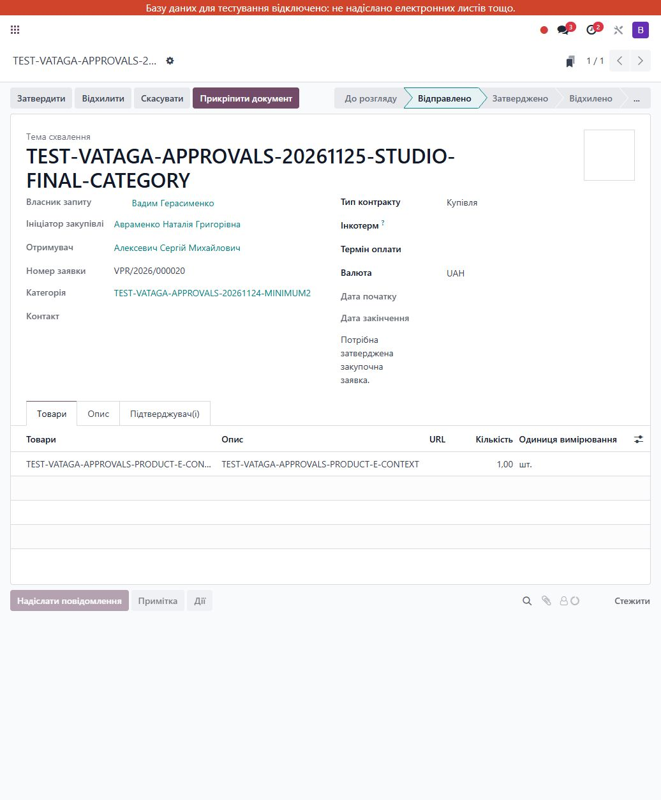

# Заключение по фактическому Studio XML / 17.0.1.0.5

Последующий разрешенный пользователем этап .6 устраняет выявленный ниже исторический display-limit отдельной проекцией marker OR native link; исходный аудит не мигрируется. [Текущий отчет .6](UAT_17_0_1_0_6_RU.md). Это историческое заключение Studio .5 включено в публикацию; его first-install/Enterprise блокеры сохраняются.

25 ноября2026, Europe/Kiev. Входные данные предоставлены пользователем из `odoo17-vataga`: модуль **NOT FOUND**, manual source-поля Many2one(hr.employee), полный Studio tree2319/priority99 и form4309/priority160. Production агентом не посещался. Никакой идентичности старой staging-базы с production не предполагается. Версия **сохранена17.0.1.0.5**: дефектов совместимости предоставленного XML не обнаружено, runtime Python/XML/JS/manifest/security/data не менялись. Дополнены только tests/fixtures, диагностические скрипты, локальный validation collector и документация. Новой бизнес-логики нет.

**Демонстрация заказчику на staging: READY в рамках текущей приемки. Рабочая первая установка на production: BLOCKED до production preflight, отдельного Install runtime и ролевой проверки.** Apps Install на production и Apps Upgrade установленной staging — разные пути. Согласование main/production и сама публикация туда не выполнялись.

## Сопоставление фактического XML

| Область | Вывод и доказательство |
|---|---|
| Form160 XPath | `//field[@name='category_id']` остается: own view90 меняет его readonly, не удаляет/переименовывает. Own дополнительные номер/тема вставляются после owner, даты меняют атрибуты, child products tree сохраняется. Полный production form payload применен native Odoo17 apply_inheritance_specs к полной объединенной staging форме, прочитанной native developer «Отримати перегляд». Ни один required own form/late-period XPath-anchor не исчез. |
| Форма: одна пара | Studio вставляет источники после category. `_get_view` вызывается после полного super/native/ERP/Studio наследования, helper находит эти nodes и не вставляет fallback. Место Studio сохраняется, XML в ir.ui.view не пишется. Повторный вызов helper не дублирует поля и не мутирует исходный arch. |
| Purchase независимо от ID | Итоговое invisible: `False if approval_type == 'purchase' else (category_id not in [9, 12])`. Для purchase любые ID/False дают видимость. Числа9/12 сохранены только внутри исходного чужого Studio XML/fixture/диагностики; бизнес-логика addon по ID не ветвится. |
| Другие типы | Сохраняется исходное invisible `category_id not in [9,12]`, включая показ для9/12 и скрытие для остальных. Исходных readonly/required/domain в supplied form нет: для nonpurchase они остаются native False/False/[]; существующие произвольные Studio modifiers покрыты прежними тестами. Native ACL/groups не расширяются. |
| Блокировка | Purchase readonly=`vataga_lines_locked`; server write защищает оба source-поля после submit/approval/возврата согласно прежней политике. Новый native stale-save получателя после submit реально отклонен сервером, прежний stale-save инициатора после approval уже PASS S11. |
| Tree99 XPath | `//tree[1]/field[@name='name']` и `//field[@name='request_owner_id']` применились native inheritance к полному исходному native approval.request tree, прочитанному без записи через техническую форму. Получен порядок name/create_date/date_start/date_end/partner_id/owner/recipient/initiator/category/activity/status. Optional recipient=show,initiator=hide сохранены. |
| «Мої схвалення» | Own addon не наследует approval.request tree, request._get_view для tree возвращает cooperative super arch без helper. Свой реестр — отдельный primary view approval.product.line; Studio request-tree не накладывается на него. Живой native список по трем TEST UAT5 записям отобразился штатно. Установленный на staging Studio tree отличается от production — employee-колонок там не создавали. |
| Значения и внешние IDs | Source-поля не объявлены/не пересоздаются и не конвертируются. Связь по technical name; существующие source/view XML IDs не присваиваются своему модулю. View helper меняет только возвращаемую копию arch. Сохранение конкретных production значений/IDs после первой установки еще требует baseline/post-install diagnostic; staging PASS не заменяет его. |
| Реестр сотрудников | Новые stored related `vataga_employee_initiator_id`→x_studio_iniciation и recipient→x_studio_who_recived имеют hr.employee. Native Field._setup_attrs/setup_related выполнены локально на реальных Odoo17 Field и текущих definitions: тип/comodel/store/compute_sudo подтверждены, source manual остается прежним. Native поиск/группы/export проверены ранее; новая2036 строка реестра показывает те же два actual employee имени. |

Точные **полные** `<data>` payload находятся в tests/fixtures/production_studio_form.xml и production_studio_tree.xml. Синтетическая упрощенная замена пользовательского XML не используется. Полные native staging XML хранятся только в ignored evidence, не распространяются как Enterprise исходники. Из локальной копии combined form удаляется ровно пара уже добавленных fallback nodes нашего постобработчика, чтобы применить Studio на его реальном этапе до helper; остальные native/ERP/own секции не сокращаются. Native tree используется целиком без удаления полей. Это проверка совместимости XML/алгоритма на известной архитектуре, не выполнение всего production registry.

Два дополнительных TransactionCase используют полный payload/priority поверх реальных native views в изолированной лицензированной БД. Временные test views создаются только внутри rollback теста, без foreign XML ID/production ID; существующие Studio views не редактируются. На shared staging эта suite не запускалась.

## Целевой браузерный retest

Только текущая сессия Вадима, uid64, тот же внутренний браузер. Рабочие документы/views/ACL не менялись; данные production не переносились. Старые массовые PASS не повторялись.

| Проверка | Результат |
|---|---|
| Исходная согласованная TEST2033 | Одна пара readonly employees182/508, owner64, прежняя approved и RFQ-связь; native Get View прочитан без записи. |
| Native список TEST UAT5 |2033/2034/2035 отображаются, стандартные колонки и статусы сохранены, исключений нет. Technical native tree прочитан, кнопка Save не нажималась. |
| Другая purchase-категория | Создана только новая TEST2036 `...STUDIO-FINAL-CATEGORY`, VPR/2026/000020, в ранее созданной TEST MINIMUM2. Реальная staging-категория14 выбрана через native dashboard, ее ID не копировался из production и ее настройка не менялась. Оба сотрудника доступны/сохраняются/reload. Это дополнительный live пример purchase вне[9,12], не подмена производственного Studio XML на staging. |
| Серверный отказ получателя | В старой вкладке2036 до submit выбран другой recipient; в основной вкладке выполнен native submit. Stale Save получил «Реквізити надісланої або обробленої закупочної заявки захищено». После discard источник остался employee508. Заявка оставлена pending, за других согласующих действий не было. Minimum/sequence блокеры не объявлены закрытыми. |
| Свой реестр2036 | Одна строка, фактические инициатор182/recipient508, количество1, pending/«Відправлено»,12 основных колонок. |
| Незакупочная TEST2035 | Approved сохраняется; видимых source widgets0; native форма работает. Это staging fallback-path, nonpurchase original Studio condition проверяется отдельно exact-XML тестом. |

## Обновленная матрица

Ранее118:107 PASS/0 FAIL/11 BLOCKED сохраняются как provenance. Parent **S19 остается BLOCKED**, но для точности учета заменен тремя подслучаями и сам повторно не суммируется:

| ID | Статус | Граница |
|---|---|---|
| S19-XML | PASS | Полные предоставленные form/tree, native inheritance на фактических staging XML, обе типовые ветки visibility/readonly, own XPath и source-related contract. |
| S19-INSTALL | BLOCKED | Первая Install на отдельной лицензированной БД с существующими Studio-полями и отдельно подготовленной историей, затем Upgrade, fingerprint и восстановление. Общая staging не деинсталлировалась. |
| S19-EE | BLOCKED | Полный реальный production Enterprise/ERP-UA registry/MRO, все прочие views/модули/компании/данные и72 ORM/HTTP-теста. Полный supplied XML не доказывает этот PASS. |

Актуальный свод **120 =108 PASS /0 FAIL /12 BLOCKED**;90 PASS — ранее принятые исторические,17 PASS этапа .5,1 XML PASS. Повторные браузерные проверки S01/S04/S05/S09/S11/S17 не увеличивали PASS. Старый U15 остается superseded. Другие BLOCKED: B04/B07/B09/C14/D11/E14/E16/E17/F09, S18; вместе с двумя S19 runtime —12.

Текущие локальные проверки: **65 portable PASS/0skip**,16 URL PASS,39 Python/8 XML parsed,6 JS syntax PASS,manifest/XML IDs/ACL/UA PO PASS. **72 Enterprise ORM/HTTP только collected, не исполнены**. Portable tests с native exports воспроизводятся при VATAGA_STAGING_ARCH_DIR и VATAGA_ODOO_SOURCE; без exported real arch два теста явно SKIP, синтетического fallback нет. Новый diagnostic отдельно проверен на точное совпадение предоставленного XML, отсутствие SQL/write/sudo/install/import-addon, стабильность hash/batch/volume-limit без вывода значений.

QUnit повторно не запускался: runtime/assets не менялись. Прежний фактический результат35/37 assertions PASS,2 внешних teardown FAIL (neutralize banner/Cloudflare), общий FAIL сохраняется. TransactionCase/HttpCase на общей staging не выполнялись.

## Первая установка: выводы и риски

Исправлена существенная ошибка **документации**: на production установка с нуля, не upgrade с .4. [Полный отдельный чек-лист перед main, Install и rollback](PRODUCTION_FIRST_INSTALL_CHECKLIST_RU.md) включает обязательные preflight на реальном production, согласованные backup DB+filestore+code, Apps Install только addon, контроль native fingerprints/Studio IDs, затем повторный Upgrade и роли. Никакие production операции в этом чате не выполняются.

По реальному Community Odoo17: manual-поля добавляются `_setup_base` до field setup; stored related проверяют тип и comodel, новые проекции получают существующие employee-ID без изменения source. `_auto_init` сохраняет existing manual columns без их переопределения, добавляет новые технические колонки/индексы/FK и планирует recompute новых stored полей на существующих строках. Custom init/migration/hooks и массовая перенумерация/утверждение отсутствуют. При установке все же есть schema/recompute работа и возможные блокировки; ее фактические объем/время на production и ERP-specific compute поведение не проверены.

Исторические статусы и native purchase links обеспечивают lock/повторный отказ RFQ без новых флагов; локальный контракт проверяет эти исходные False-флаги и сохранение native номера без присвоения VPR. Снимки согласования/технические авторы старых действий не выдумываются. Существующие неоднозначные старые строки не превращаются в разрешенные для мастера.

**Два обязательных исторических ограничения:** новый RFQ audit marker у старых связанных заявок первоначально False (FK при этом блокирует повтор), а удаленный до установки RFQ без FK/аудита неотличим от никогда не созданного. До рабочей приемки нужно отдельно согласовать корректное представление/сверку исторического RFQ; новая автоматическая миграция в этот review не добавлена. Нельзя обещать защиту от повторного формирования по утраченной до установки истории. Также у старых manual-number заявок может не быть VPR-номера. Эти ограничения не скрываются положительной демонстрацией новых заявок.

Подготовлен дополнительный **manual read-only** scripts/production_install_diagnostic.py для сравнения actual full view anchors/Studio payload/metadata/XML IDs, списка установленных addons, коллизий vataga namespace и исторических fingerprints/counts до/после Install. Он не выполнялся на production; его вывод еще нужен от администратора. Наличие потенциально конфликтующих старых vataga_* полей без установленного модуля требует остановки и schema ownership review.

Для демонстрации использовать специально подготовленные TEST2033/2036 и собственный реестр; TEST2036 остается на этапе ожидания двух согласующих. Для main/production сохраняется условие отдельного согласования и закрытия указанных install/config/roles рисков. Перенос БД, новая бизнес-логика, изменение прав и деинсталляция shared staging не выполнялись.
