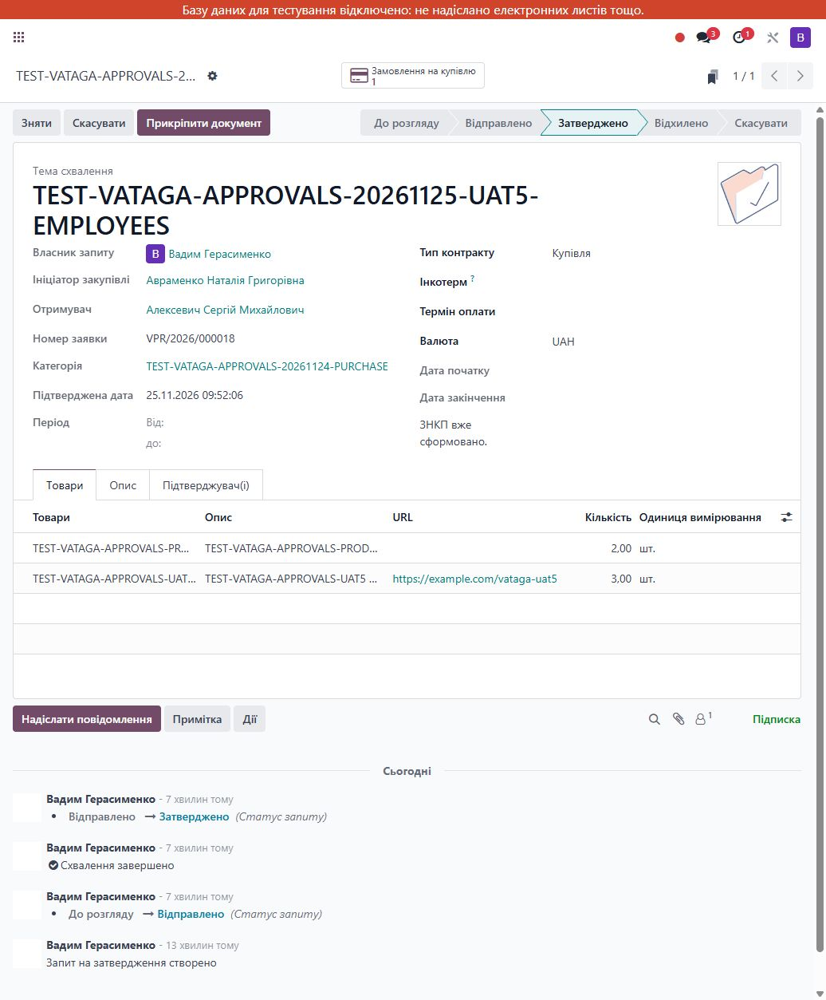
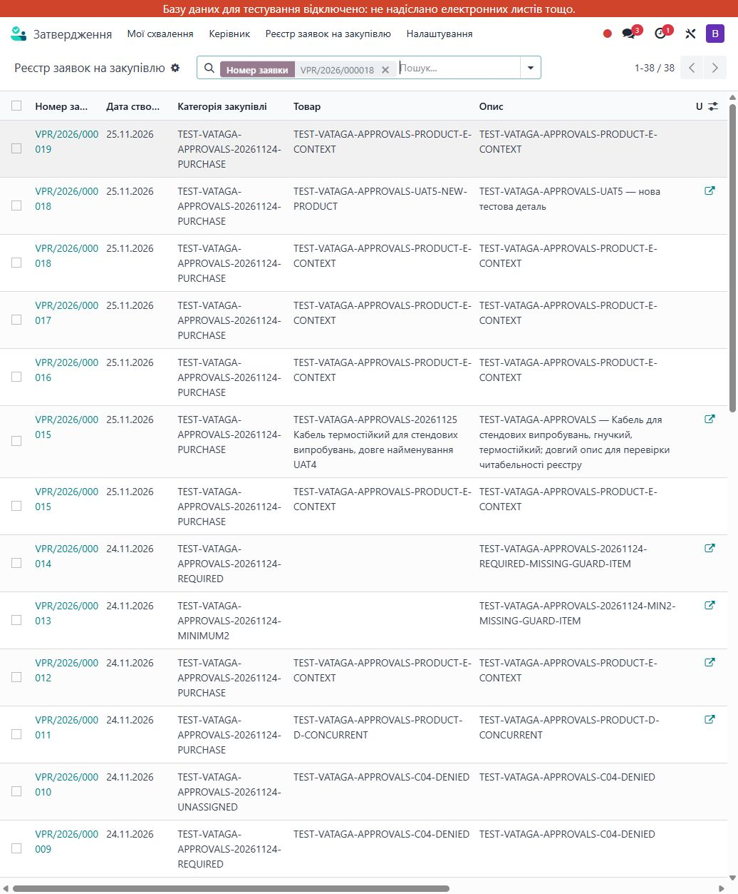
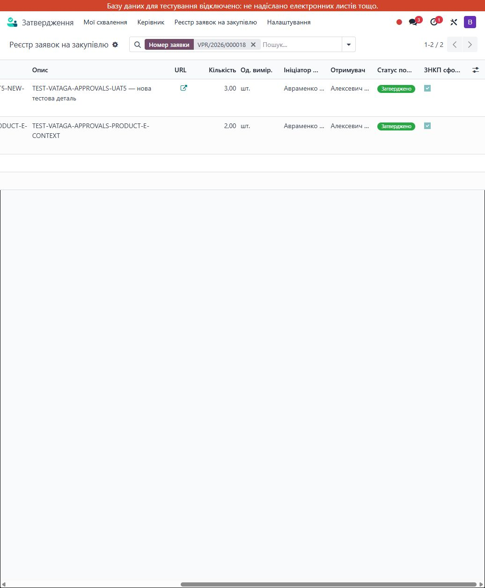

# Приемка Studio-интеграции 17.0.1.0.5

25 ноября 2026, Europe/Kiev. Только staging, текущая сессия Вадима Герасименко (uid64), без смены учетных записей, прав, паролей и компаний. Runtime commit [cd9d3b9](https://github.com/ERP-Ukraine/vataga/commit/cd9d3b93f5c23163a6435e90622323c9bd959d9d), [Actions493](https://github.com/ERP-Ukraine/vataga/actions/runs/45568363292) SUCCESS, фактический ERP-UA build3961 RUNNING с 07:29:29UTC. Apps Upgrade выполнен дважды; Apps показывает17.0.1.0.5 и «Встановлено», зависимость hr установлена. Итоговые документы публикуются отдельным коммитом без изменения runtime.

**Статус: новая функциональность прошла приемку в доступной сессии; окончательная ролевая/production-приемка BLOCKED.** Main, production, чужие модули, рабочие документы и права пользователей не изменялись. Нет имитации действий других согласующих или отрицательных ролей.

## Матрица и границы доказательств

Этот этап: **17 PASS /0 FAIL /2 BLOCKED**. Ранее принятые90 PASS сохраняются исторически, целиком не повторялись. Старый U15 (отсутствовали сведения о полях людей) **SUPERSEDED** настоящим этапом и не считается повторно ни PASS, ни BLOCKED. Остальные9 прежних BLOCKED сохранены. Актуальный свод: **118 сценариев =107 PASS /0 FAIL /11 BLOCKED**, из них90 PASS перенесены из ранее принятой матрицы. QUnit teardown и неисполненные ORM-тесты учитываются отдельно, в PASS бизнес-сценариев не маскируются.

| ID | Статус | Доказательство |
|---|---|---|
| S01 | PASS | Новая TEST-заявка2033, VPR/2026/000018: владелец uid64, инициатор employee182 и получатель employee508; все три независимы. Владелец readonly. |
| S02 | PASS | Оба сотрудника выбраны из штатного hr.employee dropdown. Создание сотрудников/аккаунтов не выполнялось; новые HR-права не выдавались. Подтвержден только положительный доступ текущей роли. |
| S03 | PASS | TEST2034,VPR/2026/000019 сохранена, отправлена и утверждена с обоими пустыми полями. Defaults сотрудников не появились. Позже отменена для S16. |
| S04 | PASS | После reload2033 оба имени сохранились; после второго Upgrade те же source-поля и значения. |
| S05 | PASS | Обе строки2033 в реестре показывают actual employees. Штатный XLSX Export all по двум отфильтрованным TEST-строкам проверен:12 колонок, оба имени в обеих строках, legacy-колонок нет. |
| S06 | PASS | Штатный поиск «Ініціатор закупівлі» по полному имени дает обе строки2033. Поиск не использует create_uid. |
| S07 | PASS | Штатный поиск «Отримувач» по полному имени дает обе строки2033. Поиск не использует res.partner. |
| S08 | PASS | Группа инициатора182:(2), сумма количества5; вложенная группа получателя508:(2), сумма5. Развернута реальная серверная read_group-группа. |
| S09 | PASS | Живой DOM2033 после второго Upgrade: ровно один widget x_studio_iniciation и один x_studio_who_recived; legacy widgets0. В Technical model699 по-прежнему103 поля и ровно два manual-имени; relation обоих hr.employee. required=False,readonly=False,store=True. Production form160 на staging не копировалась; ее полный XML покрыт границей S19. |
| S10 | PASS | Ровно12 основных колонок в DOM и XLSX, по одной новой колонке каждого сотрудника; старых нет. Optional-меню и горизонтальная прокрутка работают. Company-колонка сохраняет штатное ограничение группы. |
| S11 | PASS | После submit/approve2033 source-поля readonly. В отдельной старой вкладке2034 до submit выбран инициатор182; после утверждения в первой вкладке нажато реальное native Save во второй. Сервер вернул «Реквізити надісланої або обробленої закупочної заявки захищено». После discard/reload поле осталось пустым. Это серверный native write, не только отсутствие кнопки. Полный RPC/import/другая роль отдельно не имитировались. |
| S12 | PASS | В2033 штатный список согласующих до submit содержит только Вадима; выбор двух сотрудников не добавил согласующих. Native submit→own approve→approved, история штатных переходов сохранена. Доступ выбранных сотрудников к документу не доказывается администратором. |
| S13 | PASS |2033: существующий12093 qty2 + отсутствующий товар с описанием/URL qty3; native approve, активная кнопка в readonly-строке, мастер→новый12095→тестовый supplierinfo15UAH→RFQ. Native Odoo использовал существующий TEST-черновик15146/P14897: количество12093 выросло с1,3 до3,3, добавлен12095 qty3; прежний TEST12094 qty2,8 сохранен. Source-строки2033 остались2/3, описание/URL сохранены, флаг ЗНКП и smartbutton1; повторной кнопки нет. Заказ остался ЗНКП, не отправлен/подтвержден. Это штатное объединение, не новый отдельный RFQ и не доказательство конкурентности D11. |
| S14 | PASS | Прежняя TEST2021 имеет прежние owner/contact/category/status/номер. Native CSV выбранной единственной2021 после Upgrade: legacy author=Вадим, legacy recipient=TEST-VATAGA-APPROVALS-VENDOR-B-20261124, standard contact=...VENDOR-A-20261124, оба новых employee источника пусты. Совпадает с сохраненной до публикации формой; SQL/comodel и числовые ID не заменялись. Рабочие записи для теста не изменялись. |
| S15 | PASS | Два реальных Apps Upgrade без registry/XML/Studio ошибки. После второго103 поля, source relation/optional/editable/store сохранены, форма2033 с одним набором полей, значениями и прежним approved/RFQ. Поля предварительно созданы штатно до публикации Python .5. |
| S16 | PASS | Специально отмененная2034: собственный registry badge «Скасовано», native form status «Скасувати». QUnit сравнил own и обычный BadgeField:3/3 assertions PASS, технический cancel и decoration сохранены. |
| S17 | PASS | Новая TEST GENERAL2035: owner остается native editable, purchase-only employee fallback/URL не видны, native submit→approve проходит. Нет новых purchase-колонок/мастера. Проверена текущая staging-форма, production Studio nonpurchase XML проверен только переносимыми тестами. |
| S18 | BLOCKED | Обычный internal без HR-read: public fallback, отрицательный поиск/чтение/экспорт, выбор сотрудника без аккаунта, архив/другая компания и отсутствие новых прав у выбранного сотрудника. Текущая административная сессия не доказывает ограничения; HR-данные/компании/роли ради проверки не менялись. Есть code review реального Community17 public API и регрессионные EE-тесты, но не runtime доказательство другой роли. |
| S19 | BLOCKED | Полный production Studio form4309/tree2319 вместе с реальным Enterprise/ERP-UA набором и70 ORM/HTTP-тестов в отдельной лицензированной одноразовой БД. Production не посещался, его Studio XML не копировался; metadata недостаточно для полного PASS. |

Прежние BLOCKED: **B04/B07/B09/C14/D11/E14/E16/E17/F09**, см. [основную матрицу](BROWSER_ACCEPTANCE_RU.md) и [уточнения маршрутов/конкуренции](FOLLOWUP_ACCEPTANCE_RU.md). Сценарии minimum/required/sequence/manager и роли не объявлены закрытыми этим одноэтапным маршрутом. Два stale UI-клиента S11 не являются конкурентным RFQ-тестом.

## Исправления, миграция, локализация

- P1: прежний автор res.users и получатель res.partner не соответствовали подтвержденному бизнес-смыслу. Теперь единственный источник — существующие optional Studio-поля Many2one(hr.employee); line projections новые и типосовместимые. Объявлений этих source-полей в Python/XML data нет. Preflight до размещения кода обязателен.
- P1: защита существенных реквизитов распространена на оба source-поля. Нативные ACL/workflow не обходятся; новых HR-прав и sudo для кадровых данных нет.
- P2: cancel-надпись локализована «Скасовано» только своим badge. Карточка, стандартные selection и глобальный перевод неизменны.
- Legacy-значения сохранены, **автоматически сопоставлено0 сотрудников**. Дополнительной миграции с недостоверными соответствиями нет. Значения доступны для дальнейшей управляемой сверки под прежними правами.
- На staging созданы только два разрешенных manual-поля, затем сохранена модель. Studio view160 не создавалась. Алгоритм _get_view работает после полного super-наследования и дополняет только отсутствующие source nodes; production metadata/XML IDs не переоформляются на наш модуль.

Подписи новых реквизитов украинские, выбор сотрудников штатный, создание HR из fallback-поля запрещено options. Оформление карты и правой/левой части реестра просмотрено; на текущем1036px viewport используется native горизонтальная прокрутка. Никаких новых видимых колонок или сброса пользовательских настроек.

## Автоматические проверки

Повторно после браузера: **55 portable Python PASS**,0skip;16 URL cases PASS;35 Python/6XML parsed;6JS syntax PASS;manifest/XML IDs/ACL/UA PO PASS. **70 Enterprise ORM/HTTP tests только collected**, исполнение BLOCKED без approvals/approvals_purchase licensed runtime; на shared staging такие тесты не запускались.

Реальный staging `/web/tests?module=approvals_purchase_vataga`:5tests,4passed/1failed, **35/37 assertions PASS**. Все35 функциональных assertions PASS, два FAIL — внешний teardown: `oe_neutralize_banner` и Cloudflare beacon в body. Новый own/native cancel тест3/3 PASS; readonly button7/7, compact registry10/10+5/5, календарные даты10/10. Общий QUnit остается FAIL, внешние элементы ради зеленого результата не удалялись.

## Что остается перед рабочим использованием

[Механизм интеграции и точный будущий production-порядок](STUDIO_INTEGRATION_17_0_1_0_5_RU.md): backup/контроль Studio→read-only preflight на старом коде→не пересоздавать существующие поля→код/upgrade только своего модуля→проверка версии/Studio IDs/legacy→повторный upgrade→реальные роли. Наличие обоих source-полей требуется **до загрузки нового registry**, создание из post_init/Apps Upgrade уже поздно. Production действия сейчас не разрешались и не выполнялись.

Остаются прежние решения из [реестра бизнес-решений](BUSINESS_DECISIONS_RU.md): категории/перенос строк, строгая блокировка при approved→draft, старые неоднозначные снимки, точный список существенных реквизитов, операционные роли, схема нумерации и единицы. Семантика людей теперь явно определена пользователем, прежний пункт7 не является самостоятельным действующим решением. Архив/компании/публичный HR и полный Studio160 требуют S18/S19. Конкурентность D11 не закрыта. Полная production-совместимость не заявляется.
