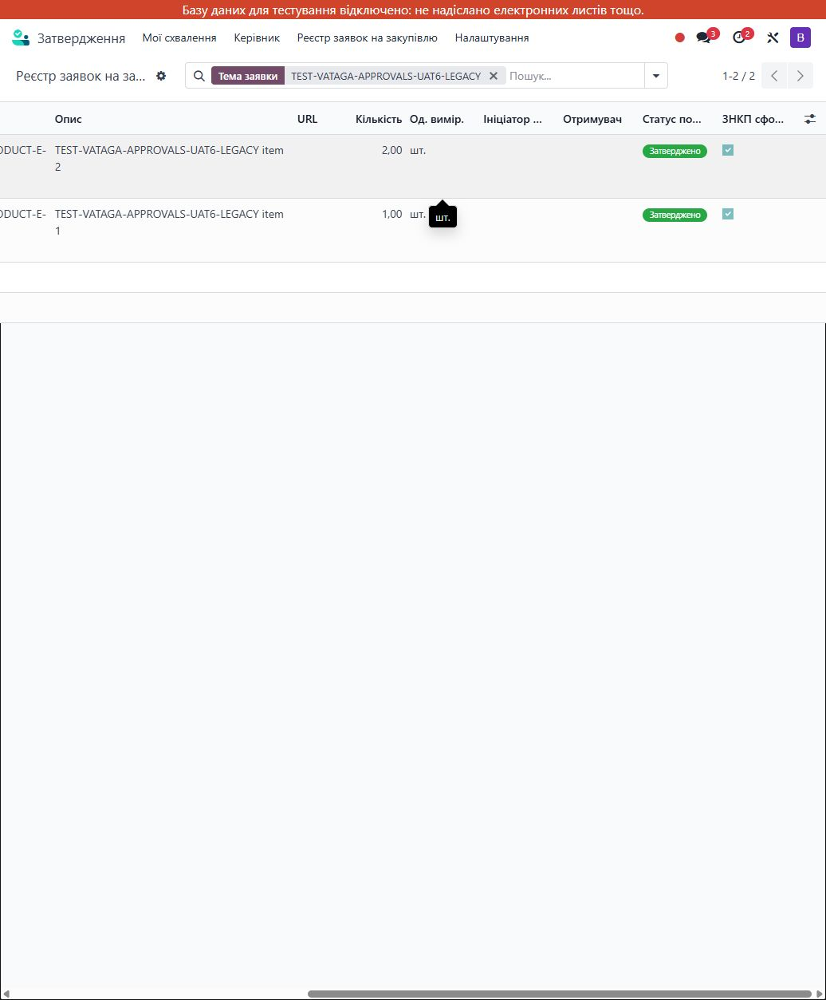

# Исторические ЗНКП и safe_eval / 17.0.1.0.6

25 ноября2026, Europe/Kiev. Runtime commit [83cdc9c](https://github.com/ERP-Ukraine/vataga/commit/83cdc9cdb93303076a9513293d9da0dfaaf790ff), [Actions495](https://github.com/ERP-Ukraine/vataga/actions/runs/45622316015) SUCCESS; ERP-UA build3963 RUNNING13:20:26UTC. Apps Upgrade выполнен через текущую сессию; native Apps подтверждает17.0.1.0.6/«Встановлено». Итоговый коммит отчета/исправленной standalone-диагностики не меняет модели/views/assets; его deployment приводится в итоговом сообщении.

Версия .6 исправляет отображение исторических закупок. Новое readonly stored поле заявки `vataga_rfq_exists` вычисляется как bool(technical marker OR ANY sibling purchase_order_line_id); строка реестра имеет одноименную related-проекцию. Все строки заявки получают одинаковое подтвержденное состояние. Колонка, фильтр «Створено ЗНКП», группировка «ЗНКП сформовано» и стандартный экспорт используют это поле. Технический `vataga_rfq_created`, дата и автор не заполняются ради отображения. Прежние RFQ guards/locks/savepoint/tombstone не переписаны и новую проекцию как разрешение не используют.

Есть только штатная инициализация/пересчет новой производной колонки при Install/Upgrade; массовой миграции аудита, нумерации, статусов или истории нет. Возраст закупки в формуле не участвует. Удаленная до Install закупка без сохранившегося FK/маркера остается неизвестной: False, без восстановления догадками.

В публикацию включены ранее незакоммиченные exact-production-Studio fixtures/tests/review и отдельный production first-install/rollback checklist. Версия .5 review сохраняет исторические результаты; .6 устраняет указанный там display-limit. S19 Install/EE и ролевые/конкурентные блокеры не закрываются этим изменением.

## Целевой набор и приемка

В staging текущей сессией создана отдельная TEST2037 `TEST-VATAGA-APPROVALS-UAT6-LEGACY`: сначала native ordinary approval текущим пользователем, отдельный TEST draft RFQ, одна штатная FK из двух строк; только новая TEST-категория затем штатно переключена в purchase. Никаких SQL/sudo/перезаписи audit fields/дат/авторов. Это legacy-like состояние с реальной связью и пустыми audit flags, **не** доказательство первой установки. Рабочие документы/категории/права не менялись; за других согласующих действий нет.

До обновления .5 обе строки показывали False. После Apps Upgrade .6 целевой этап **8 PASS /0 FAIL /0 BLOCKED**:

| ID | Статус | Фактическое доказательство |
|---|---|---|
| R01 | PASS | TEST2037: marker=False, одна FK из двух строк, request display=True и обе line_display=True. Native readonly checkbox обеих строк True после Upgrade. Date/author False; количества1/2 сохранены. |
| R02 | PASS | Прежняя TEST2036: marker=False, native links0, display=False; native checkbox реестра False. Никакой утраченной истории не присваивалось. |
| R03 | PASS | Прежняя TEST2027: marker=True, native links0 после ранее проверенного удаления, display=True; native строка реестра True. Старые фактические date/author этой TEST сохраняются, новые не выдумываются. |
| R04 | PASS | «Створено ЗНКП» поверх точного TEST2037 отбора сохраняет обе строки1/2, включая sibling без собственной FK. Колонка и filter используют одно поле. |
| R05 | PASS | Native group «ЗНКП сформовано» по всем26 TEST-строкам: Ні(13), суммаqty13; Так(13), суммаqty32. Всего26, прежние12 основных колонок. |
| R06 | PASS | Native Export all XLSX:12 колонок,2 True строки. Native контрольный CSV добавил исходную «Технічна відмітка ЗНКП» и FK: проекцияTrue/True, marker пуст/пуст, связь ровно у1 sibling, qty1/2. Файлы действительно скачаны/разобраны локально, не подменены синтетическими данными. |
| R07 | PASS | Отдельный TEST server action текущего пользователя действительно вызвал стандартный action_create_purchase_orders для2037 и получил «ЗНКП вже сформовано». Скрипт возвращал бы явный FAIL с rollback, если бы метод позволил повтор. UserError transaction не сохраняет попытку; исходный marker остаетсяFalse. Это не конкурентный D11-тест. |
| R08 | PASS | Полный standalone safe_eval script запущен native TEST server action1160 до/после Upgrade. Финальный отчет: версия6;29purchase requests/41items;9 со связью;2approved без связи;1old manual-number; статусы6new/9pending/11approved/1refused/2cancel. Имена сотрудников/рабочие значения не выводились. Production не посещался. |

При runtime-проверке диагностического counts выявлен и исправлен дополнительный дефект: dotted One2many `purchase_order_line_id=False` включал mixed-link заявку. Теперь отсутствие связи считается как исключение native множества заявок с ANY подтвержденной связью через public ORM search/IDs; нет SQL/private-query обхода. Реальный retest изменил неверное3 на корректное2, остальные counts сохранились. Добавлен portable contract и EE regression сравнения с агрегацией parent-recordset; это исправление standalone диагностики, не новая бизнес-функция.

Тестовое действие1160 read-only, без contextual/website binding и изменения групп. Действие1161 первоначально создало только TEST-набор, после этого заменено на ограниченную TEST read/repeat проверку: дополнительных создающих команд в сохраненном коде больше нет. Никаких scheduled jobs/контекстных меню/production действий не создавалось. UI lookup одной старой вкладки потребовал чистой вкладки той же сессии; итоговые checkbox проверки получены в свежем native list, без изменения записей.

## Матрица и повторные локальные проверки

Прежняя принятая матрица120:108 PASS/0 FAIL/12 BLOCKED не повторялась целиком. Добавлены R01–R08: итог **128 =116 PASS /0 FAIL /12 BLOCKED**. S19 parent остается BLOCKED: S19-XML PASS, S19-INSTALL/S19-EE BLOCKED; также прежние B04/B07/B09/C14/D11/E14/E16/E17/F09 и S18. Исправление видимости исторической закупки не подтверждает первую Install, другие роли или production MRO.

68 portable PASS/0skip с actual staging XML exports;16 URL PASS;41Python/8XML parsed;6JS syntax PASS;manifest/XML IDs/ACL/UA PO PASS. **74 Enterprise ORM/HTTP tests только collected, не исполнены**. Native QUnit/assets не менялись: прежний35/37 assertions PASS и2 внешних teardown FAIL остаются историческим результатом, общий прогон не объявлен зеленым. Новые ORM тесты исполняются только в лицензированной одноразовой БД, не shared staging.

Добавлены truth-table/audit-preservation, единый column/filter/group contract, native safe_eval compilation/read-only/denied-section privacy и два EE regression для legacy partial link/group/export/repeat denial и marker-only/unknown history. Повторно прочитанные исходные audit marker/date/author в2037 остались пустыми; не выполнялась массовая миграция исторических записей. Только штатно инициализирована новая stored-проекция.

[Полный safe_eval код](../scripts/production_safe_eval_diagnostic.py), [запуск и недоступные без shell проверки](SAFE_EVAL_DIAGNOSTIC_RU.md), [обязательный будущий первый Install/rollback](PRODUCTION_FIRST_INSTALL_CHECKLIST_RU.md). Production module NOT FOUND: нужна первая Install, а не Upgrade. Main/production не изменяются.
