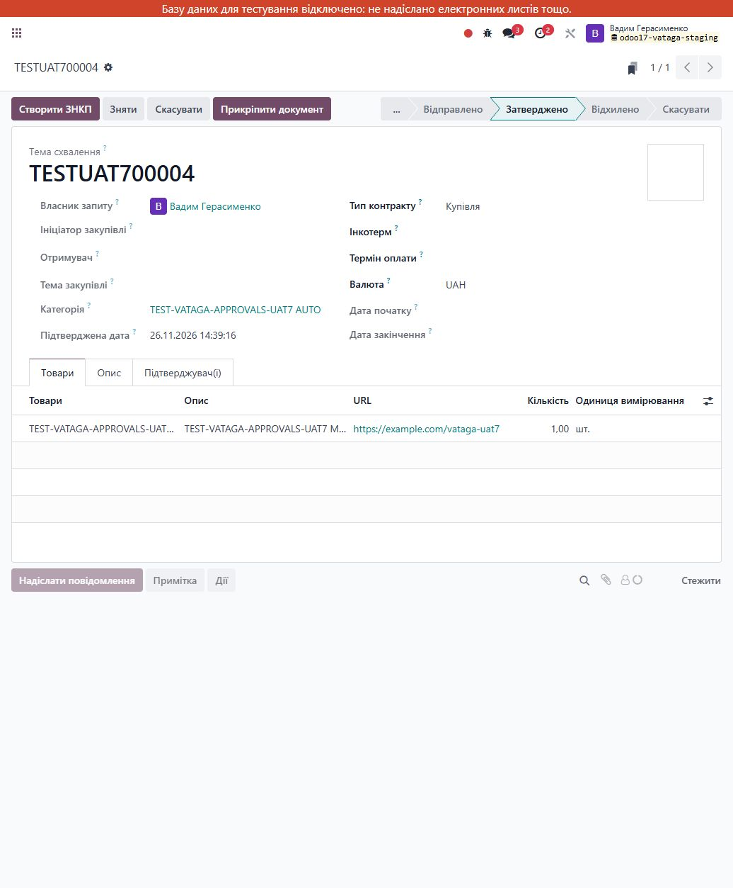
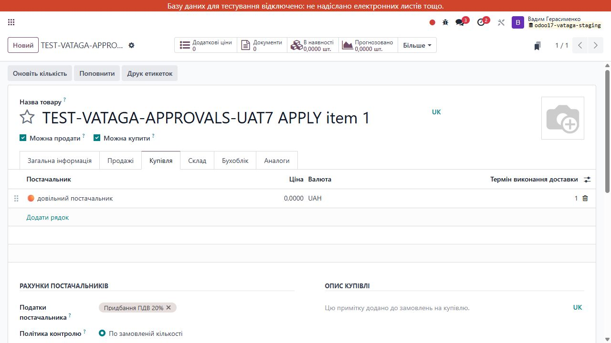
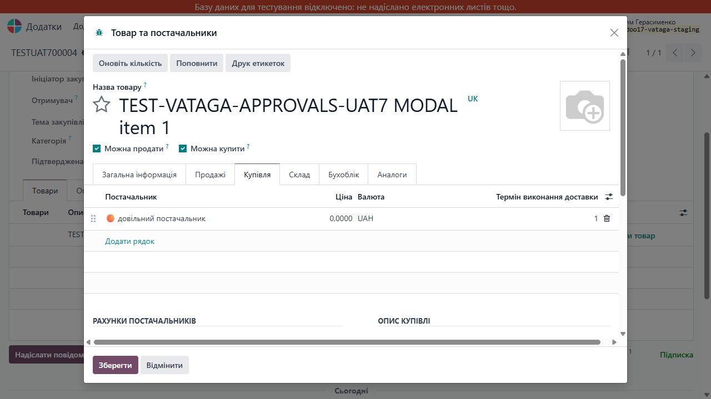

# Приемка 17.0.1.0.7

26 ноября 2026, Europe/Kiev. Этап пользовательских изменений UI01–UI05, RFQ01–RFQ08, SUP01–SUP05, MOD01–MOD05, REG01–REG03. Runtime/browser проверены текущей сессией uid64; Apps Upgrade выполнен. Основные сборки: [498](https://github.com/ERP-Ukraine/vataga/actions/runs/45820990440) build3977 и [499](https://github.com/ERP-Ukraine/vataga/actions/runs/45823332271) build3978 SUCCESS; [500](https://github.com/ERP-Ukraine/vataga/actions/runs/45825161940) с финальными scoped guards/CSS также SUCCESS. Итоговая публикация уточнения настройки ранга и отчета приводится в финальном сообщении. Прежние 128 =116 PASS/0 FAIL/12 BLOCKED сохраняются исторически, без повторного прогона/закрытия блокеров.

## Изменения

1. Собственный отдельный vataga_display_number удален из формы; поля, APPR/VPR, заголовок, реестр/ссылки/поиск/экспорт сохранены. Номера не переписываются.
2. vataga_purchase_subject остается editable в черновике автоматической категории, но его отсутствие больше не запрещает отправку/согласование. Штатный name не менялся, обязательность других реквизитов сохранена.
3. vataga_rfq_block_reason удален только из формы. Расчет готовности, кнопка и все серверные отказы сохранены.
4. Native action_create_purchase_orders/MRO выполняется отдельно для каждой заявки внутри общего savepoint. Закрытый ContextVar, привязанный к курсору, создает случайный технический ключ, который сервер добавляет только новым purchase.order. Фактически проверенный approval.product.line._get_purchase_orders_domain(partner) дополняется этим ключом только во время формирования одной заявки: прежние черновики исключены, новые документы этой же заявки доступны штатной группировке. Native ACL/rules, seller/price/currency/taxes/UOM/stock preparations не переписаны. Прямые попытки изменения старого PO/POL в этой области отклоняются; postcondition проверяет новые ID и все связи. Ключ readonly/copy=False, ручной ввод/изменение запрещены; RPC context не активирует область. Общий PO _search вообще не переопределяется. Вне области native approval domain возвращается неизменным. Это не глобальное отключение merge и не monkeypatch. Схема добавляет техническую колонку/индекс purchase.order; исторические записи не получают вымышленных ключей. Native Enterprise источники локально отсутствуют; shell preflight/full ORM/полный MRO и сложные склады требуют отдельной проверки, анализ кода не считается runtime PASS.
5. На staging read-only найдена ровно одна запись «довільний постачальник»:2951, active=True, supplier_rank=1, company=False, XML ID отсутствует. Числовой ID не входит в runtime-код. Вместо ненадежного поиска по названию используется обязательная явная конфигурация res.company.vataga_default_supplier_id на вкладке «Закупочні заявки Vataga». Она выбирает существующую запись штатным Many2one, без создания/дубликатов и без выдачи прав. На production ответственный администратор должен самостоятельно указать своего контрагента после preflight/Install; staging ID туда не переносить. Пустая/неактивная/неподходящая настройка дает ошибку до создания товара. При нескольких одноименных записях автоматического выбора нет: требуется осознанный выбор администратора. Новый товар из обеих кнопок мастера получает supplierinfo в общем savepoint с товаром и строкой. Существующие товары не меняются. Price намеренно не передается: штатный default Odoo17 —0.0; это не полученная цена поставщика. Покупщик обязан проверить/исправить цену перед дальнейшей закупкой; draft RFQ может иметь нулевую цену, подтверждение/отправка не выполняются тестами. Если ERP-UA изменяет defaults, используется его фактическое значение, а не жестко заданный ноль.
6. get_formview_action() product.product сохраняет стандартную форму и очищенный product context; target='new'. Native action_service Odoo17 заменяет исходный wizard dialog, передавая onClose родительской формы следующему dialog. Кнопка без открытия по-прежнему возвращает act_window_close. Копия формы/глобальные product actions/кастомный reload JS не добавлены; runtime сохранение/возврат/обновление проверяются отдельно.

## Локальные проверки перед публикацией

78 portable PASS,16 URL PASS;45 Python/9 XML parse,6 JS syntax,manifest/XMLIDs/ACL/UA PO PASS.83 EE ORM/HTTP tests collected, NOT EXECUTED: approvals/approvals_purchase лицензированного runtime нет. В новые регрессии входят отказ переиспользования старого draft с точным сравнением состава/количества/цен/налогов, группировка внутри заявки, два поставщика, исключение на втором PO с rollback первого, import пустой темы, обе кнопки мастера/пустая конфигурация/атомарность supplierinfo, modal target, cursor/context isolation и cleanup при исключении. Portable tests не заменяют реальный concurrency/Enterprise.

## Production

Только будущий первый Apps Install по отдельному чек-листу, не Upgrade с .6. Перед публикацией в main нужен актуальный production preflight, существующие два Studio hr.employee поля, сохраненная цепочка views и выбранный существующий поставщик в новой настройке компании. Backup DB+filestore+code, проверенный restore; не Uninstall на общей staging. Main, production, чужие модули, права, пароли, рабочие документы и исторические закупки не изменяются. Production не является копией staging.

Фактический native hook подтвержден через read-only вызов на TEST-заявке: `_get_purchase_orders_domain(partner)` возвращает company/partner/draft и `picking_type_id` из approvals_purchase_stock. Подготовленный TEST15158 действительно найден штатным ORM по этому домену до создания; TEST2054 создала другой15159, исходные header/line IDs/qty/price/taxes/UOM/date_planned не изменились. Поэтому финальная реализация использует именно этот локальный hook, а не общий PO search. Полные исходники/MRO Enterprise при этом не объявляются прочитанными.

При целевой приемке найден P2: перенос длинной ссылки номера создавал некликабельный промежуток inline-фрагментов. Нажатие в промежутке открывало строку, по самому тексту — правильную заявку. Локальный inline-block делает всю прямоугольную область ссылки кликабельной; финальная проверка центра выполняется после публикации этого CSS. Данные/действия/компактные ширины не меняются. В guards POL добавлен немедленный native delegate вне закрытой RFQ-области, без дополнительных чтений order_id; внутри области проверяются также результаты super.create/write, чтобы расширение не могло незаметно подменить order_id.

## Итоговая целевая матрица

**28 =23 PASS /0 FAIL /5 BLOCKED**:26 обязательных IDs и2 отдельных транзакционных сценария. Предыдущие128 =116 PASS/0 FAIL/12 BLOCKED не прогонялись целиком и не закрывались: свод **156 =139 PASS /0 FAIL /17 BLOCKED**. Исторические PASS относятся к своему принятому этапу; это не156 заново выполненных тестов версии .7.

| ID | Статус | Фактический результат |
|---|---|---|
| UI01 | PASS | TEST2045 automatic TESTUAT700001: отдельного номера нет, заголовок/номер сохранены. |
| UI02 | PASS | TEST2049 manual: отдельного номера нет; VPR/2026/000022 найден, выгружен и открывает правильную заявку из реестра. |
| UI03 | PASS | Пустая тема: create/draft/native submit/approve2045; штатный load пустой темы2046/2047 перед согласованием. Name/номер не переписывались. Заполненная тема2050 найдена и отображена optional-колонкой. |
| UI04 | PASS | Draft/pending/approved, refused2058 и cancel2051: informational block отсутствует; в последних двух DOM count reason-field/number-label=0. |
| UI05 | PASS | Native серверные отказы: повтор2045, отсутствие товара2051 до отмены, draft/cancel статус. Мастер запрещает повтор заполнения. Кнопки продолжают отражать готовность; права других ролей не подтверждены. |
| RFQ01 | PASS | Native `_get_purchase_orders_domain(partner)` фактически возвращает company/partner/draft/picking_type311.15158 реально найден этим доменом до операции;2055 создала15160, старый header/line IDs/qty/price/taxes/UOM/date_planned точно сохранены. |
| RFQ02 | PASS | A2045→15151; B2046→15152; финальные E2055→15160 и F2056→15161/15162 также отдельные; поставщик A общий. |
| RFQ03 | PASS | A две строки1+2→один POL qty3; финальная F три строки, две поставщика A→одна новая закупка/POL qty3. |
| RFQ04 | PASS | C2047→два новых PO15153/15154; финальная F2056→15161/15162 разных поставщиков. |
| RFQ05 | PASS | Исходный15150/35803 qty7 price17 unchanged по до/после и финальному чтению. Квалифицированный15158/35811 qty3 price17 и восемь прежних TEST-orders также сравнены точным read до/после F. |
| RFQ06 | PASS | Фактический повтор native action по2045 дал «ЗНКП вже сформовано»; количества/связи не увеличились. |
| RFQ07 | BLOCKED | Базовые runtime реквизиты подтверждены: цены17/23, taxes12, UAH, company1, UOM шт., warehouse→picking311, все FK. Полное сочетание иных валют/UOM/складов и Enterprise/ERP-UA MRO не выполнено; прежний F09 не закрыт. |
| RFQ08 | BLOCKED | Регрессия с ошибкой на втором поставщике и rollback первого добавлена, но только collected в83 EE tests. Принудительную инъекцию исключения на общей staging не делали. Успешные операции/ранний отказ не объявлены доказательством rollback второго PO. |
| SUP01 | PASS | Обе native кнопки new: MODAL12101/supplierinfo12207, APPLY12102/supplierinfo12208. Изначально выбран существующий2951, по одной строке supplierinfo, default price0/UAH. |
| SUP02 | PASS | Existing12099 сохраняет единственную supplierinfo12205/vendorA/price17; default2951 к нему не добавлен. Проверена стандартная карточка в modal. |
| SUP03 | PASS | По одному supplierinfo для обоих new продуктов; повтор того же wizard фактически отклонен, TEST product count4 сохранен. Изолированный extension-already-added branch имеет отдельную EE регрессию, ее исполнение не подтверждено. |
| SUP04 | BLOCKED | Отсутствующая настройка реально дала понятный ValidationError до создания товара; после явной настройки тот же wizard успешно продолжен. Сценарий нескольких одноименных кандидатов добавлен в EE-suite, не исполнен; реальные дубли контрагента на shared staging не создавались. Автоматического выбора/создания партнера нет. |
| SUP05 | PASS | В native modal new12101 поставщик изменен с2951 на TEST vendorB5761, price0→31; после Save backend подтвердил сохранение. Последующее native RFQ2048 создало отдельный15163. |
| MOD01 | PASS | New и existing открывают стандартный product.product form в target=new поверх исходной заявки. |
| MOD02 | PASS | Вкладка «Купівля» видима и редактируема согласно текущим правам; сохранены vendor/price. |
| MOD03 | PASS | Save new modal и закрытие existing modal вернули в прежние2048/2050; исходного wizard больше нет. |
| MOD04 | PASS | Родитель сам перечитан: заполненный product/UOM и доступная «Створити ЗНКП», без ручного reload страницы. |
| MOD05 | PASS | Обычная «Заповнити» на manual2049 закрыла wizard и обновила строку/готовность, product form не открывала. |
| REG01 | PASS | TEST2037 markerFalse/native link1/displayTrue/qty1,2; TEST2027 markerTrue/link0/displayTrue/qty1. Никаких backfill дат/авторов/номеров или исторических PO записей. |
| REG02 | PASS | Registry number search/group/native XLSX12cols,1row/True/номер; optional subject2050; реальные Studio fields на формах категорий19/20. P2 клика wrapped-number исправлен: display inline-block, centerHitsLink=True, native click одним переходом открыл2049, не line67. |
| REG03 | PASS | Новый ordinary2057: native submit/approve=approved, исходная обязательность description сохранена: штатный load пустого описания отклонен. Закупочные поля/защиты не навязывались другому типу. Это не полная приемка всех установленных дополнительных модулей. |
| TX01 | BLOCKED | Две native кнопки одновременно через Promise.all в двух вкладках2049: один PO15155, второй отказ «ЗНКП вже сформовано». Клиентский интервал277ms; серверное перекрытие/ожидание lock не измерено, D11 остается BLOCKED. |
| TX02 | BLOCKED | Ошибка supplierinfo.create после product.create: изолированная EE regression добавлена, не исполнена. Ранний отказ конфигурации и успешное создание не заменяют эту проверку. |

Старые BLOCKED **B04/B07/B09/C14/D11/E14/E16/E17/F09, S18, S19-INSTALL, S19-EE** сохранены. Parent S19 BLOCKED, S19-XML PASS. Все новые runtime-проверки выполнены текущим пользователем; за других согласующих действий не было. Native backend проверки запускались через отдельное TEST server action, без SQL/sudo/import/расширения прав. Сохраненный код1161 после приемки заменен read-only отчетом; contextual/website binding не создавались, cron отсутствует. Safe_eval не разрешил with/savepoint в одном тестовом коде; обход не применялся, для отрицательного ordinary-description сценария использован штатный load с его внутренним rollback.

78 portable/16 URL PASS;45Python/9XML/6JS syntax/manifest/XMLIDs/ACL/UA PO PASS.83 EE ORM/HTTP только collected. Полный QUnit не повторялся: прежние35/37 assertions PASS и2 внешних teardown FAIL остаются историческим результатом; новый CSS проверен реальным browser hit-test/кликом. Зеленый общий QUnit/Enterprise прогон не заявляется.

## TEST-документы и доказательства

Все закупки остаются draft: поставщикам не отправлялись, не подтверждались, складские операции не выполнялись.

| Заявка | Новые ЗНКП |
|---|---|
| [A2045](https://vataga-staging.erpu.cloud/web#id=2045&model=approval.request&view_type=form) | [15151](https://vataga-staging.erpu.cloud/web#id=15151&model=purchase.order&view_type=form) |
| [B2046](https://vataga-staging.erpu.cloud/web#id=2046&model=approval.request&view_type=form) | [15152](https://vataga-staging.erpu.cloud/web#id=15152&model=purchase.order&view_type=form) |
| [C2047](https://vataga-staging.erpu.cloud/web#id=2047&model=approval.request&view_type=form) | [15153](https://vataga-staging.erpu.cloud/web#id=15153&model=purchase.order&view_type=form), [15154](https://vataga-staging.erpu.cloud/web#id=15154&model=purchase.order&view_type=form) |
| [Modal2048](https://vataga-staging.erpu.cloud/web#id=2048&model=approval.request&view_type=form) | [15163](https://vataga-staging.erpu.cloud/web#id=15163&model=purchase.order&view_type=form) |
| [Apply2049](https://vataga-staging.erpu.cloud/web#id=2049&model=approval.request&view_type=form) | [15155](https://vataga-staging.erpu.cloud/web#id=15155&model=purchase.order&view_type=form), нулевая default цена реально сохранилась |
| [Eligible E2055](https://vataga-staging.erpu.cloud/web#id=2055&model=approval.request&view_type=form) | [15160](https://vataga-staging.erpu.cloud/web#id=15160&model=purchase.order&view_type=form), подходящий старый [15158](https://vataga-staging.erpu.cloud/web#id=15158&model=purchase.order&view_type=form) сохранен |
| [Final F2056](https://vataga-staging.erpu.cloud/web#id=2056&model=approval.request&view_type=form) | [15161](https://vataga-staging.erpu.cloud/web#id=15161&model=purchase.order&view_type=form), [15162](https://vataga-staging.erpu.cloud/web#id=15162&model=purchase.order&view_type=form) |

При review дополнительно снято необоснованное требование supplier_rank>0: в Odoo это счетчик использования, не право покупки. Настройка и resolver проверяют фактический доступ, активность, имя и компанию, а права создания supplierinfo — native ACL. Rank на staging1 не менялся. На production не нужно искусственно менять rank/группы. Runtime не содержит2951/номеров категорий/сотрудников/представлений. Пустая настройка намеренно требует выбора администратора, даже если совпадение имени одно; это надежная явная идентификация без угадывания.

Итог: READY для контролируемой демонстрации на staging в проверенной сессии; не безусловная готовность первой production Install/всех ролей/сложных закупок. Перед main актуальный production preflight, выбранный существующий supplier компании, отдельный Install/restore и закрытие необходимых BLOCKED по [чек-листу](PRODUCTION_FIRST_INSTALL_CHECKLIST_RU.md). Staging не идентична production. Новых бизнес-функций за пределами задания нет; main/production/чужие модули/рабочие документы/права/пароли не изменялись.
