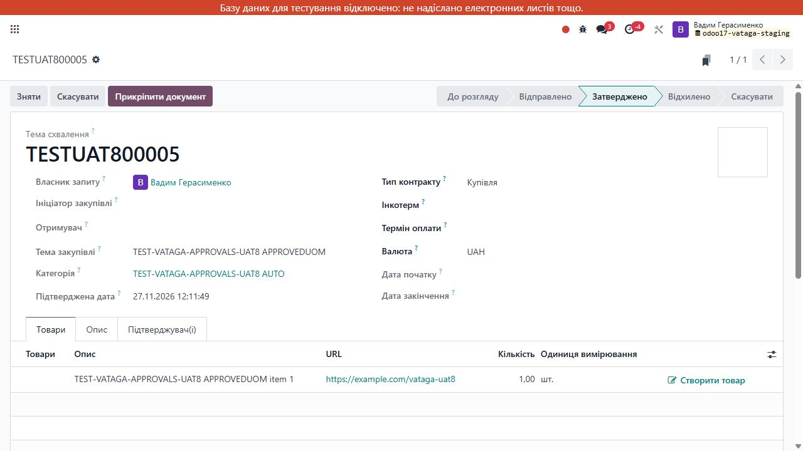
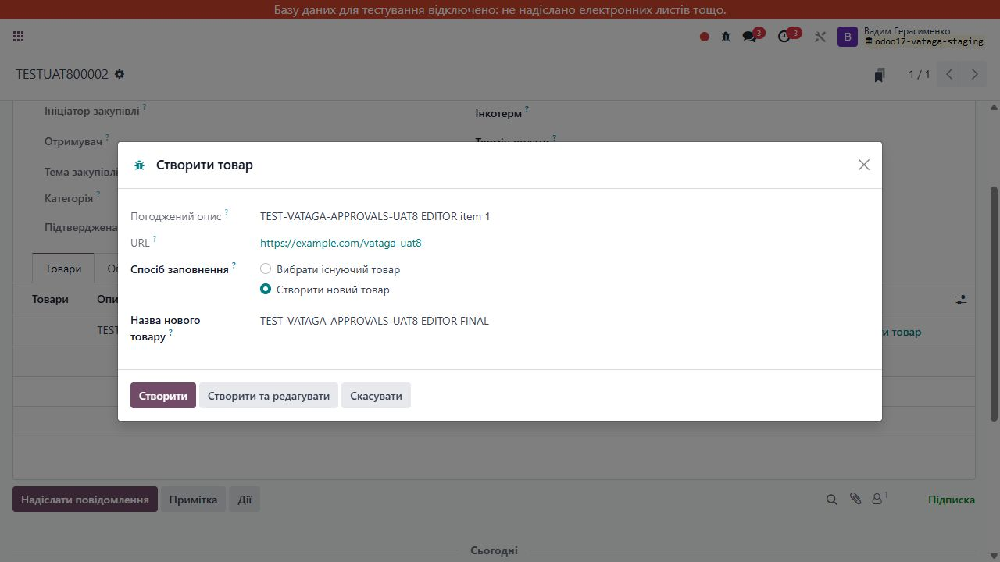
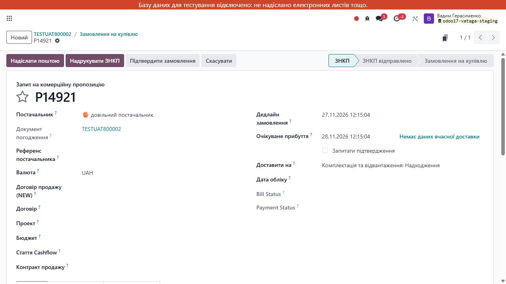
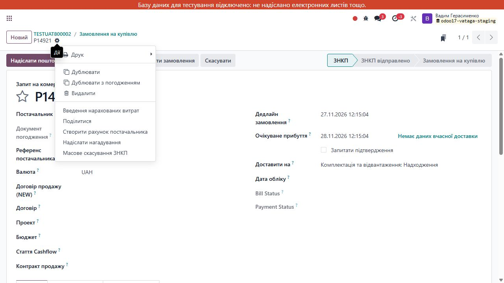
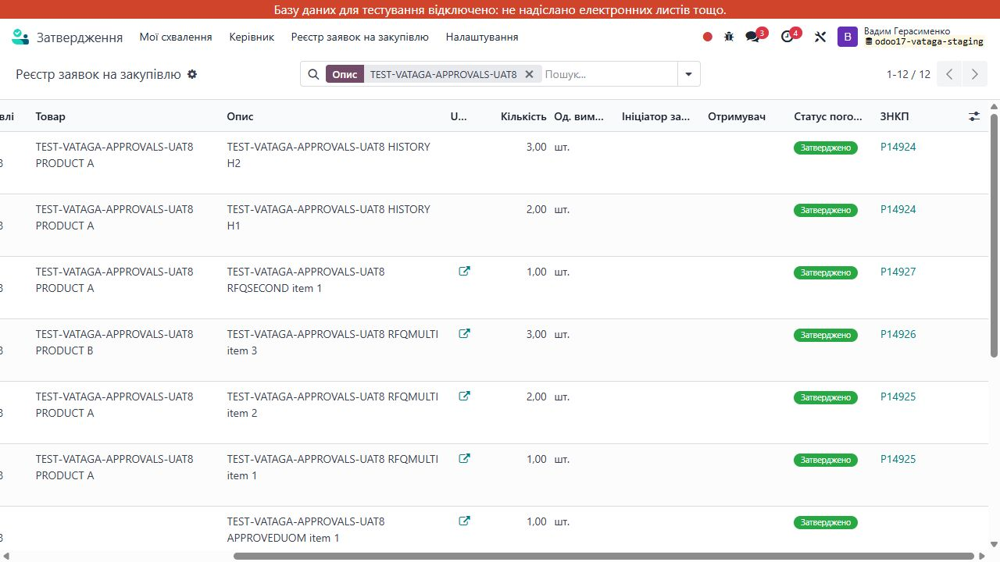

# Приемка 17.0.1.0.8

**17.0.1.0.8 установлена на staging, 27.11.2026. Контролируемая desktop-демонстрация готова.** Обязательная целевая матрица: **35 PASS / 0 FAIL / 2 BLOCKED**. С тремя дополнительными проверками: **36 PASS / 0 FAIL / 4 BLOCKED**. Production и перенос в main не выполнялись. Тесты — только текущая внутренняя браузерная сессия uid64, без impersonation, изменения прав/паролей/компаний и рабочих документов.

## Изменения

- Тема обязательна при первой отправке редактируемой новой purchase-заявки, включая прямой `action_approve()` из new. Автоматическая категория проверяет отдельную тему, ручная — `name`; whitespace не принимается. Пустой черновик разрешен. Неизменяемая approved/legacy история, вернувшаяся штатно в new, освобождена от требования редактировать уже readonly тему: lock и прежний workflow сохранены, значения не дописываются. Штатная обязательность названия для других типов восстановлена ограничением ORM и modifier формы.
- «Створити товар», «Створити», «Створити та редагувати»: desktop, mobile, мастер и сообщение защиты переименованы. Имена методов/XML ID сохранены.
- Причина дефекта единиц в .7: `_apply()` создавал товар и фиксировал UOM строки до открытия карточки. Последующие изменения товара не меняли защищенный снимок строки. Теперь `action_apply_open_product()` ничего не создает. Локальный nested FormViewDialog использует полную штатную карточку product.product. Cancel/X/Escape закрывают только карточку, оставляя сохраненный мастер. Native `web_save` под контекстом конкретного собственного мастера выполняет создание/изменение товара, supplierinfo и разрешенное заполнение строки в одном savepoint под блокировкой заявки. При несовместимой явно согласованной UOM операция откатывается. Обычная кнопка остается немедленной. `unlink` для отмены не используется.
- Новые закупки сохраняют readonly Many2many источников `vataga_origin_approval_ids`; UI `vataga_approval_request_ids` объединяет доступные источники и достоверные исторические native связи строк, без анализа `origin`. Несколько заявок отображаются отдельными ссылками. Нет backfill старых документов.
- Отдельное серверно защищенное действие вызывает штатный `copy()` и сохраняет только ссылку. Исходные line FK, audit и RFQ key не переносятся. Обычный Duplicate связь не копирует. Копия явно не подтверждает согласование измененных позиций.
- Реестр использует nonstored `vataga_purchase_order_id` из native FK конкретной строки. Read/search/group/export маскируют недоступные PO/POL штатными ACL/rules и компаниями текущей сессии, без sudo. Узкие SQL/order hooks обслуживают только это поле; другие поля делегируются super. Технические факты формирования и прежние фильтры сохранены.

## Локальные проверки

**92 portable Python PASS; 16 URL PASS; 48 Python /11 XML, PO/manifest/XML ID/ACL и 8 JS syntax PASS. 97 Enterprise ORM-тестов только collected, не исполнены:** лицензированные исходники отсутствуют. Прежние83 также не считаются исполненными. Новые тесты: пустая тема/черновик, cancel без DB-effect, final UOM/vendor, rollback несовместимой UOM и ошибки заполнения, unchanged existing confirmation, forged editor identity, native/special copy, historical multi-reference, ACL-masked registry, protected input, native Many2one group-order parser, name/NULL/negative search, field-level denial. Полный production Studio XML продолжает проходить прежние portable regressions; S19 runtime не закрыт.

Первая установка и конкурентная окончательная запись требуют отдельного лицензированного окружения; TransactionCase/HttpCase на общей staging не запускаются.

Дополнительный локальный PostgreSQL-пробник NULL-group не исполнился: прежний тестовый localhost55491 выключен (connection refused). Прежний standalone lock-protocol не перезапускался, так как сам протокол блокировки не менялся. Этот пробник не записан в PASS; runtime ветка скрытого PO остается частью заблокированной ролевой/Enterprise-приемки.

## Матрица

Исходная .7: **139 PASS / 0 FAIL / 17 BLOCKED**, не объявляется повторно выполненной. Успешная optional-topic проверка .7 отменена новыми требованиями и заменяется TOP01/TOP02; доказательства .7 сохранены в прежнем отчете.

| ID | Итог | Фактическое доказательство |
|---|---|---|
| TOP01 | PASS | Auto2065 и manual2066: пустое значение и пробелы отклонены сервером с «Вкажіть тему закупівлі»; пустые черновики сохранены. После review дополнительно4 прямых action_approve из new отклонены, state=new/audit=False |
| TOP02 | PASS | После ввода темы обе заявки pending; исходные TESTUAT800001/VPR/2026/000023 сохранены. На финальном коде auto/manual прошли pending→approved с неизменными номерами; обычный nonpurchase прошел native workflow без отдельной темы |
| TOP03 | PASS | TEST2073/2074 approved без темы читаются. На финальном коде2073 прошла approved→new(readonly)→pending→approved с пустой темой, тем же номером/FK и без line snapshot. Весь диагностический цикл откатан, исходные flags отдельно сверены |
| UI01 | PASS | Desktop кнопка, мастер, footer и сообщение защиты; фактический generated mobile kanban содержит одну новую подпись и не содержит старой. Мобильный runtime отдельно MOB01 |
| UOM01 | PASS | Товар12114 сохранен с uom_id=uom_po_id=5 «м», строка94 также5, approved UOM отсутствовала |
| UOM02 | PASS | Реестр и XLSX строки94 показывают «м» |
| UOM03 | PASS | P14921/POL35826:1м, цена18,50; штатные native закупочные вычисления |
| UOM04 | PASS | У строки97 явно согласована1 «шт.»; сохранение нового товара с5 «м» отклонено, product/supplierinfo/audit откатились. Позднее строка использована для CON01 с совместимой единицей |
| MOD01 | PASS | Создание происходит на Save; закрылись обе модали, родитель обновился автоматически |
| MOD02 | PASS | «Відмінити» вернул в исходный мастер с mode=new и введенным EDITOR FINAL |
| MOD03 | PASS | IDs/count products и supplierinfo до/при открытии/после отмены идентичны, см. таблицу ниже |
| MOD04 | PASS | После отмены line94 product=False, filled/created=False, filled_at=False |
| MOD05 | PASS | X и Escape вернули мастер; оба DB-сравнения также2/2 с теми же IDs |
| MOD06 | PASS | После трех отмен создан ровно один12114 и один12219; повторное заполнение отклонено |
| MOD07 | PASS | На TEST12112 временная новая name отменена; БД не изменилась, line96 пустая. Последующее Save неизмененной карточки корректно заполнило строку без создания товара |
| MOD08 | PASS | Обычная «Створити»: product12116/supplierinfo12221 созданы сразу, line95 заполнена |
| LINK01 | PASS | P14921 хранит источник2067 и показывает кликабельный TESTUAT800002; прежний собственный TEST P14906 показывает именно VPR/2026/000022, а не текст темы |
| LINK02 | PASS | Реальный click P14927→TESTUAT800007 открыл request2072 |
| LINK03 | PASS | P14925/P14926 обе содержат источник2071; строки по двум поставщикам |
| LINK04 | PASS | Штатная копия P14923 без источников не показывает пустой хедер; специального пункта меню нет |
| LINK05 | PASS | P14924 отображает TESTHIST800001 и TESTHIST800002 по двум native FK; raw sources=[], marker=False |
| DUP01 | PASS | «Дублювати з погодженням» рядом с native Duplicate, фактический menu click |
| DUP02 | PASS | P14921→P14922: отдельный новый номер, draft, без подтверждения/отправки |
| DUP03 | PASS | P14922 сохраняет2067; UI предупреждает, что ссылка не подтверждает согласование измененных строк |
| DUP04 | PASS | Native Duplicate P14922→P14923: источники=[], computed refs=[], copy flag=False |
| DUP05 | PASS | Машинное точное сравнение request/audit/order/POL до и после совпало |
| DUP06 | PASS | У обеих копий origin_key=False; исходная line94 по-прежнему POL35826. invoice_ids/picking_ids/advance_move_line_ids имеют фактический native copy=False; у копий они пусты, move/invoice lines пусты, received/invoiced0 |
| DUP07 | BLOCKED | Нет другой реально авторизованной роли. Отказ копии без источника/подмене refs текущей сессией не заменяет эту проверку |
| REG01 | PASS | Вместо checkbox видны actual PO names; технические поля сохранены |
| REG02 | PASS | Click P14927 в реестре открыл PO15176, а не форму строки |
| REG03 | PASS | Две строки2071→P14925, третья→P14926 |
| REG04 | PASS | Пять строк без native закупки имеют пустой PO; False-domain вернул именно их |
| REG05 | PASS | Прочитан прежний собственный TEST2027: marker=True, FK=[], registry PO=False; в UI нет неработающей ссылки. Нового удаления не выполнялось |
| REG06 | PASS | UI search P14925→ровно2 строки; group/expand, пустая группа, прежний fact filter→7, nine search conditions и XLSX12 строк сверены |
| REG07 | PASS | После обеих копий у2067 одна registry-строка; ссылка остается P14921; всего UAT8 строк12 |
| SEC01 | BLOCKED | Текущая сессия:12 предусмотренных серверных отказов PASS. Реальные другие роли, hidden PO record rules/field groups и компании не имитировались |
| RFQ01 | PASS | Перед2072 P14925 реально подходил native grouping domain; создан новый P14927; P14925/P14926 qty/price/UOM не изменились |

Дополнительные проверки:

| ID | Итог | Объем доказательства |
|---|---|---|
| AT01 | PASS | Реальный post-create отказ по несовместимой UOM откатил новый товар, seller и все изменения строки/аудита; без fault injection/shared TransactionCase |
| CON01 | BLOCKED | Две вкладки, два мастера и два Save dispatched в одном Promise.allSettled: B создала12117/12222; A получила already-filled. Счетчики4/4→5/5. Перекрытие транзакций не инструментировано, поэтому конкурентный proof не закрыт |
| MOB01 | BLOCKED | Requested390×844, но оба фактических DOM измерения1280×720. Override сброшен; screenshot1280 не выдается за мобильный PASS |

Другие17 старых блокеров, в том числе первая Install/полное лицензированное Enterprise/production Studio runtime/реальные роли, сохраняются в предыдущей матрице. Их не прибавляем повторно к целевому этапу. Полный QUnit не перезапускался и не объявляется зеленым; прежние внешние teardown failures сохраняют прежний статус.

## Данные отмены и итоговое сохранение

| Момент | product.product IDs | supplierinfo IDs | line94 |
|---|---|---|---|
| До редактора |12112,12113|12217,12218|product=False, audit=False|
| Редактор открыт |12112,12113|12217,12218|Без изменений|
| После «Відмінити» |12112,12113|12217,12218|Без изменений|
| После X |12112,12113|12217,12218|Без изменений|
| После Escape |12112,12113|12217,12218|Без изменений|
| После Save |Добавлен только12114|Добавлен только12219|product12114, UOM5 «м», filled/created=True|

В карточке пользователь изменил единицу и цену поставщика18,50 — обе сохранены. Для явно согласованной строки97 несовместимая попытка оставила прежние3 товара/3 seller и пустую строку с согласованной1 «шт.». Позднее обычный Create добавил12116/12221, затем парная попытка CON01 — ровно12117/12222. Итоговые UAT8 products5/sellers5; это ожидаемые успешные создания, не остатки отмен. Даты/авторы прошлых закупок не вымышлялись; последовательности могут иметь обычные пропуски после неуспешных транзакций.

Проверка текущего объема:96 доступных purchase-строк, page80,32 PO-группы; read+group около0,012с внутри одного прогретого серверного вызова, без сетевого времени. Это не load test production. Массовые записи не создавались.

## Найденные дефекты и review

P0 нет. Исправлены P1: прежнее eager-создание оставляло товар при отмене; промежуточная UOM замораживалась до редактирования; в первой .8 реализации native group order обрезал scalar SELECT; ERP-UA display_name search возвращал все закупки, а Query NOT IN пропускал NULL FK. Поздний review также подтвердил обход обязательной темы прямым action_approve из new и блокировку readonly-истории после возврата в new. Все подтвержденные дефекты исправлены и соответствующие browser retest пройдены. Новые требования к подписям/ссылкам реализованы отдельно от этих дефектов.

Code review: критические пути используют полный native MRO; web_save вне контекста нашего мастера сразу делегируется super. Проверяются владелец transient, исходная строка/заявка, реальные ACL/rules/company, product identity и повторное заполнение; JSON-флаг не воспроизводит private capability. На открытие редактора нет мутаций/блокировки; блокировка и savepoint только на окончательном сохранении. Native unchanged-existing save явно подтверждается отдельным web_save({}, spec), поскольку Odoo17 обычно пропускает такой RPC. Это отдельная операция выбора без предшествующей записи товара.

Read/search/group/export PO применяют одинаковый native visibility scope, включая source field-level checks; при отказе источник не читается. SQL hook использует PK LEFT JOIN с native rule-filtered Query и возвращает единственный column token, совместимый с реальным Odoo17 group parser; посторонние поля делегируются super. В header скрытые заявки отфильтрованы native search. Копирование не подменяет line FK и не меняет исходный approved snapshot. Дополнительных ACL/групп/маршрутов согласования не добавлено. Непроверенные роли остаются BLOCKED, несмотря на этот review.

## Публикация и тестовые документы

- [Реализация d674b2e](https://github.com/ERP-Ukraine/vataga/commit/d674b2ec29426c53f91edcd6284ab27f87cf07d7): [Actions502](https://github.com/ERP-Ukraine/vataga/actions/runs/45979412867), ERP-UA3983 running, Apps Upgrade, installed17.0.1.0.8.
- [Grouping fix4cd464e](https://github.com/ERP-Ukraine/vataga/commit/4cd464e29e57e220cc8dd8f132f07107ca92f974): [Actions503](https://github.com/ERP-Ukraine/vataga/actions/runs/45981936127), ERP-UA3984 running, Apps Upgrade и group retest PASS.
- [Search/NULL fix d528fa6](https://github.com/ERP-Ukraine/vataga/commit/d528fa6785c581e25e2802baf044808faa14325c): [Actions504](https://github.com/ERP-Ukraine/vataga/actions/runs/45982898167), ERP-UA3985 running, Apps Upgrade и целевой retest PASS. Финальный сопроводительный commit содержит эту матрицу, снимки, дополнительные tests и shell preflight.
- [Direct approval guard2adcf97](https://github.com/ERP-Ukraine/vataga/commit/2adcf97f9d4fdaf50db77f4fa5e15c9502ab4139): [Actions505](https://github.com/ERP-Ukraine/vataga/actions/runs/45986254069), ERP-UA3986 running.
- [Readonly legacy compatibility0289618](https://github.com/ERP-Ukraine/vataga/commit/0289618940d17667fb854aa5487dfcd5ab5c4d7a): [Actions506](https://github.com/ERP-Ukraine/vataga/actions/runs/45987593866), ERP-UA3987 running; Apps Upgrade,4 direct-negative topic cases, auto/manual/nonpurchase positive native workflow и legacy cycle/rollback retest PASS. Это финальный runtime-код .8.

TEST2073/2074 — специально созданная legacy-shape fixture: обычная новая TEST-категория, native approvals и настоящие purchase line FK, затем только эта новая категория переключена в purchase. Аудит не подделывался. Это не production-копия и не утверждение, что документы существовали до установки. Дополнительно read-only проверен реально существовавший до .8 собственный TEST P14906/VPR.

[Основная заявка2067](https://vataga-staging.erpu.cloud/web#id=2067&model=approval.request&view_type=form&cids=1), [P14921](https://vataga-staging.erpu.cloud/web#id=15170&model=purchase.order&view_type=form&cids=1), [специальная P14922](https://vataga-staging.erpu.cloud/web#id=15171&model=purchase.order&view_type=form&cids=1), [обычная P14923](https://vataga-staging.erpu.cloud/web#id=15172&model=purchase.order&view_type=form&cids=1), [историческая P14924](https://vataga-staging.erpu.cloud/web#id=15173&model=purchase.order&view_type=form&cids=1), [двухпоставочная2071](https://vataga-staging.erpu.cloud/web#id=2071&model=approval.request&view_type=form&cids=1), [независимая2072](https://vataga-staging.erpu.cloud/web#id=2072&model=approval.request&view_type=form&cids=1), [товар12114 «м»](https://vataga-staging.erpu.cloud/web#id=12114&model=product.product&view_type=form&cids=1). Все остаются TEST, закупки draft; поставщикам не отправлялись, не подтверждались, складских операций нет.

[Доказательства и экспорт](evidence/17_0_1_0_8/README.md). Снимки не редактировались; состояния отражают соответствующие шаги приемки, до поздней CON01. Горизонтальная прокрутка реестра сохранена.

## Ограничения совместимости

Если сторонний модуль уже задает `js_class` формы purchase.order, он сохраняется. Наш локальный controller не заменяет неизвестный ERP controller; пункт меню в такой форме требует отдельного интеграционного решения. На текущей staging native форма не имеет js_class. Production должна пройти отдельный read-only preflight, в том числе этот контракт; старая staging не подтверждает полное равенство production.

На production модуль еще не установлен: будущая операция — **Apps Install**, не Upgrade; до размещения кода обязательны оба Studio employee-поля, preflight зависимостей/полей/представлений, резервная копия и согласованное окно. Main/production этой публикацией не затрагиваются. Действует отдельный [чек-лист первой установки и отката](PRODUCTION_FIRST_INSTALL_CHECKLIST_RU.md).
